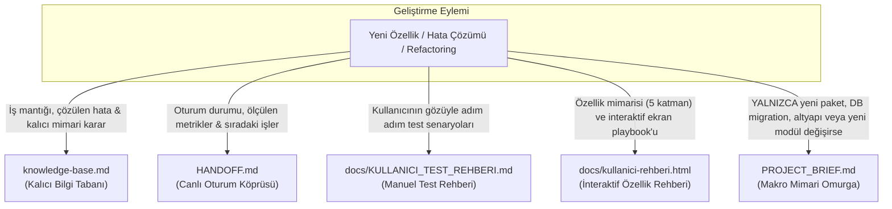

# 📐 Canlı Proje Özeti ve Mimari Senkronizasyon (PROJECT_BRIEF.md)

> Bu kural `skillSetWorks` çatısını kullanan **tüm projelerde** (frontend, backend, fullstack, CLI) istisnasız geçerlidir.
> AI kod ajanları çalıştıkları projenin mimari gerçekliğini tek bir yaşayan belgede konsolide tutmakla yükümlüdür.

---

## 0. Tek Doğruluk Kaynağı: `PROJECT_BRIEF.md`

`PROJECT_BRIEF.md`, projenin güncel teknolojisini, kütüphane sürümlerini, veritabanı şemasını, dizin haritasını ve bağlayıcı kararlarını tek sayfada toplayan konsolide zihin haritasıdır.

⛔ **Bu dosya asla bayat bırakılamaz ve tahminle doldurulamaz.**
Canlı kod tabanındaki değişiklikler aynı oturumda bu dosyaya yansıtılmalıdır.

---

## 1. Kod Ajanının Temel Sorumlulukları ve Güncelleme Tetikleyicileri

`PROJECT_BRIEF.md`, projenin bir özellik günlüğü (Changelog) veya oturum hafızası değildir; **projenin makro düzeydeki canlı mimari omurgası ve teknik kimlik kartıdır**.

### 1.1 Hangi Koşullarda Güncellenir? (5 Anayasal Koşul)

Ajan aşağıdaki 5 temel durumda `PROJECT_BRIEF.md` dosyasını senkronize etmekle yükümlüdür:

| # | Koşul | Somut Örnek | `PROJECT_BRIEF.md`'de Neresi Değişir? |
|---|---|---|---|
| **1** | **Bağımlılık ve Stack Değişikliği** | `pnpm add driver.js`, `npm i lucide-react`, `pom.xml`, `requirements.txt` eklenmesi veya framework major sürüm artışı | Frontmatter `frameworks:` listesi ve `§1 Teknoloji Yığını & Altyapı` |
| **2** | **Veritabanı Şeması ve Migration** | Yeni bir SQL migration dosyası (`*.sql`), yeni tablo/kolon, RLS kuralı, enum veya Prisma entity'si | Frontmatter `database:` listesi ve `§4 Veritabanı Modeli & Migration Politikası` |
| **3** | **Altyapı & Sunucusuz İşlevler (Infra/Edge)** | Yeni bir Edge Function (`supabase/functions/`), `Dockerfile`, `docker-compose.yml`, Netlify/Vercel konfigürasyonu | `§1 Altyapı` ve `§2 Dizin Ağacı` |
| **4** | **Bağlayıcı Kararlar & Doküman Referansları** | Kalıcı bir mimari karar (ADR) alınması, `knowledge-base.md` kararı veya yeni doküman (PRD, test rehberi, özet dokümanı) eklenmesi | Frontmatter `related_docs:`, `depends_on:` ve `§3 Bağlayıcı Kararlar & Dış Referanslar` |
| **5** | **Yeni Dizin / Modül Sorumluluğu** | Projeye yeni bir modül, Web Worker motoru (`src/modules/search/worker/`) veya çekirdek servis katmanı eklenmesi | `§2 Dizin Ağacı & Modül Sorumlulukları` tablosu |

### 1.2 Ne Zaman Güncellenmez? (İş Mantığı vs. Mimari Omurga Ayrımı)

⛔ **`PROJECT_BRIEF.md` bir Changelog veya Sprint Task Listesi DEĞİLDİR.**
Aşağıdaki durumlarda dosya **değişmez ve stabil kalır**:
- Yeni bir UI bileşeni, sayfa veya form kodlandığında (harici yeni kütüphane veya yeni DB tablosu gerektirmediği sürece),
- Mevcut servisler içinde yeni fonksiyonlar, hook'lar veya yardımcı fonksiyonlar yazıldığında,
- Birim testleri, e2e testleri veya entegrasyon testleri eklendiğinde,
- Hata ayıklama (bug fix) ve dahili refactoring yapıldığında.

💡 **Ajan Yanılgısı Örneği (Bookmark Manager Vakası):**
Bookmark Manager projesinde Web Worker ile arka plan arama motoru ve çevrimdışı okuma önbelleği kodlanmıştır (2.000+ satır yeni kod). Bu geliştirme çok kapsamlı olmasına rağmen yeni bir harici npm paketi ve yeni bir veritabanı migration'ı içermediği için ajanın `§1 Teknoloji Yığını` ve `§4 Veritabanı` bölümlerini stabil bırakması doğrudur; ancak projeye eklenen yeni Web Worker arama motorunu `§2 Dizin Ağacı & Modül Sorumlulukları` tablosuna işlememesi eksikliktir.

### 1.3 Temel Dokümantasyon Mimarisi ve Görev Dağılımı

Hangi bilginin nereye yazılacağı aşağıdaki görev paylaşım matrisiyle kesin olarak ayrılmıştır:



| Doküman | Sorduğu Temel Soru | Güncellenme Sıklığı | Kapsamı |
|---|---|---|---|
| **`PROJECT_BRIEF.md`** | *"Bu proje hangi dille, hangi paketlerle, hangi DB ile ve hangi modül yapısıyla ayakta duruyor?"* | Yalnızca mimari, paket, DB ve altyapı değiştiğinde | Makro mimari omurga |
| **`docs/kullanici-rehberi.html`** | *"Yapılan özellikler arka planda nasıl inşa edildi (5 katman) ve ekranda adım adım nasıl kullanılır?"* | Her anlamlı özellik geliştirmesinden sonra | İnteraktif özellik playbook'u |
| **`HANDOFF.md`** | *"Biz şu an hangi sprintteyiz, hangi testler yeşil ve sıradaki 1-3 görev nedir?"* | Her görev bittiğinde ve oturum sonunda | Canlı görev panosu & oturum köprüsü |
| **`knowledge-base.md`** | *"Bu projede hangi kök hataları çözdük ve hangi mimari kararları aldık?"* | Yeni hata çözüldüğünde veya karar alındığında (append-only) | Kalıcı tecrübe kütüphanesi |
| **`docs/KULLANICI_TEST_REHBERI.md`** | *"Kullanıcı tarayıcıyı/konsolu açtığında özellikleri gözüyle nasıl doğrulayacak?"* | Kullanıcı akışını değiştiren her çıktıda | Manuel kabul test adımları |

⛔ **Sahte 'Stabil' Beyanı Yasağı (Anti-Lazy Stabil Declaration):**
Git çalışma ağacında bağımlılık manifesti (`package.json`, `pom.xml`, `requirements.txt` vb.), yeni bir servis/sunucusuz fonksiyon (örn. Edge Function, worker) veya veritabanı şeması/migration'ı değiştirilmişken devir raporunda `PROJECT_BRIEF.md: Değişiklik yok / stabil` beyanında bulunmak ağır kural ihlalidir. Bu dosya canlı mimariyi yansıtmak zorundadır.

---

## 2. Dosya Konumu ve Şablonu

- **Konum:** `<repo-kök>/PROJECT_BRIEF.md` (Repo kökünde, `HANDOFF.md` ile aynı seviyede yer alır).
- **İlk Kurulum / Şablon:** Projede dosya yoksa, `.agent/templates/PROJECT_BRIEF.template.md` şablonu kopyalanarak veya `ProjectInitializer` / `generate_project_brief.py` CLI'si ile oluşturulur.
- **Dağıtım Koruması:** `PROJECT_BRIEF.md` yaşayan, projeye özel bir belgedir. `delivery.py` bu dosyayı merkezi olarak ezmez; projede kendi durumunu korur.

---

## 3. Deterministik Doğrulama Kapısı (`check_project_brief.py`)

Kural `OLCULEBILIR` sınıfındadır. Oturum tesliminden veya commit onayından önce aşağıdaki komut çalıştırılır:

```bash
python .agent/skills/musgoku/scripts/check_project_brief.py
```

### Kapı Kontrolleri:
- **E1 (Dosya Eksik):** Proje kökünde `PROJECT_BRIEF.md` bulunamadı.
- **E2 (Bozuk Frontmatter):** YAML frontmatter eksik veya zorunlu alanlar (`title`, `type: project-brief`, `primary_language`) tanımlanmamış.
- **E3 (Bağımlılık Sapması - Git Diff Drift):** Git çalışma ağacında `package.json`, `pom.xml`, `requirements.txt` vb. değişmiş ama `PROJECT_BRIEF.md` güncellenmemiş!
- **E4 (DB / Şema Sapması - Git Diff Drift):** Git çalışma ağacında migration veya DB modelleri değişmiş ama `PROJECT_BRIEF.md` güncellenmemiş!
- **E5 (Kırık Dosya Bağlantısı):** Frontmatter'daki `related_docs` listesindeki dosya yolları diskte mevcut değil.
- **E6 (Edge Function / Altyapı Sapması - Git Diff Drift):** Git çalışma ağacında sunucusuz işlev (`supabase/functions/**`, `netlify/functions/**`) veya altyapı yapılandırması (`Dockerfile`, `docker-compose.yml`, `wrangler.toml`, `supabase/config.toml`) değişmiş ama `PROJECT_BRIEF.md` güncellenmemiş!
- **E7 (Şablon Yer Tutucusu):** `PROJECT_BRIEF.md` içinde doldurulmamış şablon yer tutucusu (`[PROJE_ADI]`, `[proje-slug]`, `[YYYY-MM-DD]`) bırakılmış.
- **W1 (Tarih Sapması):** Dosya içeriği değiştiği halde frontmatter'daki `updated` alanı bugünün tarihini taşımıyor.

E1-E7 kodları **hata (exit 1)** üretir ve commit/handoff sürecini bloke eder.

- 💡 **Çift Yönlü Güvenlik Ağı (Dual Mapping Guard):** `check_db_migrations.py` kapısı da simetrik olarak `E5` (Dual Mapping Drift Guard) denetimiyle donatılmıştır; dolayısıyla bir ajan yalnızca veritabanı kapısını çalıştırsa dahi `PROJECT_BRIEF.md` güncellenmeden `exit 0` alamaz. Mimari ve şema asla birbirinden kopamaz.

---

## Proje Bazlı Ek Kurallar

> Bu bölüm projeye özeldir. Altında yalnızca projenin özel mimari notları yazılır.
