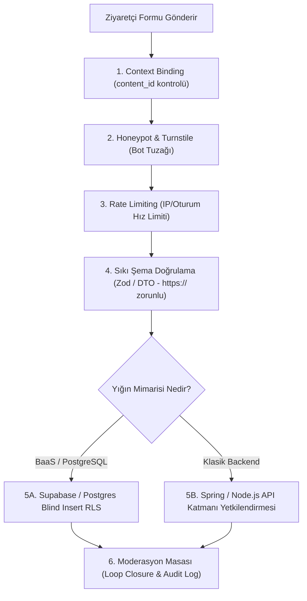

# Açık ve Anonim Formlar İçin Güvenlik ve Moderasyon Mimarisi
*(Universal Public Form Security & Moderation Architecture)*

---

## 1. Neden Bu Standart Var?

Web uygulamalarında oturum açmamış (anonim / public) ziyaretçilerden veri toplayan formlar (hata bildirimi, tarih değişikliği, iletişim, ürün incelemesi, içerik şikayeti, geri bildirim vb.) sistemin en savunmasız giriş noktalarıdır.

Bu formlar uçtan uca doğru tasarlanmadığında iki büyük felakete yol açar:
1. **İstismar & DoS:** Bot saldırıları, spam, veritabanı şişirme, XSS ve veri sızıntısı (başkalarının verilerini okuma).
2. **Sahte Tamamlama (Phantom Implementation):** Verilerin backend'e bağlanmayıp sadece `localStorage`'da bırakılması ya da veritabanına girse bile karşılayacak bir editör/moderasyon ekranı olmadığı için "ölü veri" olarak çürümesi.

> ⛔ **ALTIN KURAL:** Açık bir formdan gelen girdi **doğrudan canlı veriyi DEĞİŞTİREMEZ**. Her açık form bir **Revizyon / Talep Önerisidir (Proposal Ticket Pattern)**. Moderasyon masasında yetkili tarafından onaylanmadıkça canlı veriye dokunulamaz.

---

## 2. DB-Agnostic 6 Savunma Katmanı (Her Yığın İçin Ortak)

Projede hangi veritabanı veya dil kullanılırsa kullanılsın, şu 6 katman zorunludur:



| Katman | Mekanizma | Koruduğu Tehdit |
|---|---|---|
| **1. Context Binding** | Formun serbest metin yerine geçerli bir `target_id` / `content_id` ile eşleşmesi. | Saldırganın hayali varlıklar uydurarak DB'yi kirletmesini engeller. |
| **2. Honeypot** | CSS ile gizlenmiş görünmez input alanı (`hp_field`). | Formu dolduran otomatik botlar doldurur; doluysa istek sessizce düşürülür. |
| **3. Turnstile / Captcha** | Cloudflare Turnstile ile görünmez insan doğrulaması. | Gelişmiş headless bot ağlarını (Puppeteer/Playwright) engeller. |
| **4. Rate Limiting** | IP veya oturum başına sınır (ör. 1 saatte max 3 bildirim). | DoS ve brute-force bombardımanını API girişinde keser. |
| **5. Strict Sanitization** | Zod / Java Bean Validation ile karakter tavanı ve URL protokol kontrolü (`https://`). | Stored XSS ve injection saldırılarını engeller. |
| **6. Blind Insert** | Anonim kullanıcı yalnızca YAZAR (Insert). Başkalarının kayıtlarını ASLA OKUYAMAZ (Select = Kapalı). | Kişisel veri sızıntısını ve casusluğu önler. |

---

## 3. Veritabanı ve Yığın Bazlı Uygulama Desenleri

Projelerin kullandığı veritabanı ve mimariye göre yetkilendirmenin uygulanacağı yer değişir.

### Desen A: Supabase & Native PostgreSQL (BaaS / Direct-to-DB Modeli)

PostgreSQL yerel **Row Level Security (RLS)** desteğine sahiptir. Anonim kullanıcı doğrudan REST/GraphQL üzerinden tabloya erişebilir, ancak güvenlik RLS ile veritabanı çekirdeğinde kilitlenir:

```sql
-- 1. Bildirim Tablosu
CREATE TABLE IF NOT EXISTS public.content_corrections (
    id UUID PRIMARY KEY DEFAULT gen_random_uuid(),
    content_id UUID NOT NULL REFERENCES public.contents(id) ON DELETE CASCADE,
    suggested_date TIMESTAMPTZ NOT NULL,
    source_url TEXT NOT NULL,
    notes TEXT,
    reported_by_ip_hash TEXT, -- Rate limit ve spam analizi için anonimleştirilmiş IP özeti
    status TEXT NOT NULL DEFAULT 'pending' CHECK (status IN ('pending', 'approved', 'rejected')),
    reviewed_by UUID REFERENCES auth.users(id),
    reviewed_at TIMESTAMPTZ,
    rejection_reason TEXT,
    created_at TIMESTAMPTZ NOT NULL DEFAULT now()
);

CREATE INDEX idx_corrections_content_status ON public.content_corrections(content_id, status);

-- 2. RLS Politikaları: KÖR EKLEME (Blind Insert)
ALTER TABLE public.content_corrections ENABLE ROW LEVEL SECURITY;

-- Anonim ziyaretçi SADECE INSERT yapabilir (Kendi eklediğini dahi geri okuyamaz):
CREATE POLICY "Public anonymous insert corrections"
ON public.content_corrections
FOR INSERT
WITH CHECK (
    status = 'pending' 
    AND reviewed_by IS NULL 
    AND source_url ~* '^https://'
);

-- Anonim veya standart kullanıcılar SELECT / UPDATE / DELETE yapamaz!
-- Yalnızca 'content_approver' veya 'admin' rolündekiler okuyabilir ve yönetebilir:
CREATE POLICY "Approvers and admins can manage corrections"
ON public.content_corrections
FOR ALL
TO authenticated
USING (
    EXISTS (
        SELECT 1 FROM public.user_roles ur
        WHERE ur.user_id = auth.uid()
        AND ur.role IN ('content_approver', 'admin')
    )
);
```

---

### Desen B: Klasik Backend + MySQL / PostgreSQL / Oracle (Spring Boot / Node.js Modeli)

MySQL, SQLite veya kurumsal ilişkisel DB'lerde Postgres tarzı RLS politikaları bulunmaz veya tercih edilmez. Bu yığında güvenlik **API ve Service Katmanında (Spring Security / Controller)** kilitlenir:

#### 1. Entity & Repository
```java
@Entity
@Table(name = "content_corrections")
public class ContentCorrection {
    @Id
    @GeneratedValue(strategy = GenerationType.UUID)
    private UUID id;

    @Column(nullable = false)
    private UUID contentId;

    @Column(nullable = false)
    private OffsetDateTime suggestedDate;

    @Column(nullable = false)
    private String sourceUrl;

    private String notes;

    @Enumerated(EnumType.STRING)
    @Column(nullable = false)
    private CorrectionStatus status = CorrectionStatus.PENDING;

    private UUID reviewedBy;
    private OffsetDateTime reviewedAt;
}
```

#### 2. Controller Seviyesinde Yetki Ayrımı (API Boundary)
```java
@RestController
@RequestMapping("/api/corrections")
public class ContentCorrectionController {

    private final ContentCorrectionService service;

    // 1. PUBLIC ENDPOINT: Anonim herkes erişebilir (Blind Insert)
    // Sadece kayıt oluşturur; hiçbir liste veya veri döndürmez!
    @PostMapping("/public/report")
    public ResponseEntity<Void> submitReport(
            @Valid @RequestBody CreateCorrectionDto dto,
            HttpServletRequest request) {
        
        // Honeypot kontrolü: Bot alanı doluysa sessizce 200 dön (botu uyandırma)
        if (dto.getHpField() != null && !dto.getHpField().isBlank()) {
            return ResponseEntity.ok().build();
        }

        service.createPendingReport(dto, request.getRemoteAddr());
        return ResponseEntity.status(HttpStatus.CREATED).build();
    }

    // 2. PROTECTED ENDPOINTS: Sadece Approver ve Admin rollerine açıktır!
    @GetMapping("/admin/pending")
    @PreAuthorize("hasAnyRole('APPROVER', 'ADMIN')")
    public ResponseEntity<Page<ContentCorrectionDto>> getPendingReports(Pageable pageable) {
        return ResponseEntity.ok(service.getPendingReports(pageable));
    }

    @PostMapping("/admin/{id}/approve")
    @PreAuthorize("hasAnyRole('APPROVER', 'ADMIN')")
    public ResponseEntity<Void> approveReport(
            @PathVariable UUID id,
            @AuthenticationPrincipal UserPrincipal currentUser) {
        service.approveAndApplyCorrection(id, currentUser.getId());
        return ResponseEntity.noContent().build();
    }
}
```

---

## 4. Moderasyon Masası ve Döngü Kapanışı (Loop Closure)

Veri toplandıktan sonra editörün onaylama adımı **3 atomik işlemi** aynı transaction içinde yürütür:

1. **Canlı İçerik Güncellemesi:**
   - `contents.target_date` = bildirilen yeni tarih.
   - `contents.source_url` = doğrulanmış resmi kaynak URL.
   - `contents.verified_at` = `now()`.
2. **Tarihçe & Denetim Kaydı (Audit Log):**
   - Varsa `content_date_history` tablosuna otomatik log atılır:
     * `old_target_date`, `new_target_date`, `reason`, `changed_by` (editör ID'si).
3. **Bildirim Kaydının Kapatılması:**
   - `content_corrections.status = 'approved'`, `reviewed_by = editor_id`, `reviewed_at = now()`.

Reddedilirse:
- Canlı veriye dokunulmaz.
- `content_corrections.status = 'rejected'` yapılır ve red gerekçesi kaydedilir.

---

## 5. Doğrulama Kontrol Listesi (Ajan İçin Pre-Flight)

Ajan açık form içeren bir işi teslim etmeden önce şu soruları yanıtlamak zorundadır:

- [ ] Anonim kullanıcı başkalarının form kayıtlarını listeleyebiliyor mu? (**Cevap KESİNLİKLE HAYIR olmalıdır.**)
- [ ] Botları engelleyecek görünmez Honeypot veya Captcha alanı var mı?
- [ ] IP / Session bazlı hız limiti (Rate Limiting) tanımlandı mı?
- [ ] Girdi alanları için URL protokolü (`https://`) ve maksimum uzunluk kısıtları konuldu mu?
- [ ] Editörün bu bildirimleri inceleyebileceği bir arayüz veya bildirim mekanizması kuruldu mu?
- [ ] Canlı veriyi güncellerken geçmiş denetim kaydı (audit log) atılıyor mu?
