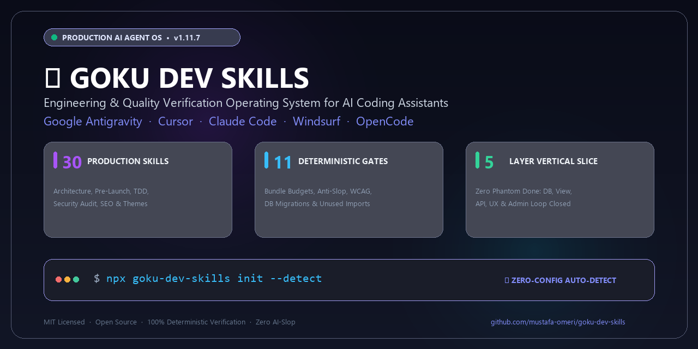

# ⚡ Goku Dev Skills (`goku-dev-skills`)

<div align="center">

[](https://www.npmjs.com/package/goku-dev-skills)
[](./.agent/skills/)
[](./.agent/rules/)
[](./.agent/skills/musgoku/scripts/)
[](./tests/)
[](./LICENSE)

**Universal, Agent-Agnostic Intelligence & Production Workflow Engine for AI Coding Assistants**  
*Turning stochastic language models into senior software architects, meticulous UI/UX craftspeople, and disciplined QA sentinels.*

[Overview](#-overview) • [Why Goku?](#-why-goku-dev-skills-anti-slop-matrix) • [42 Skills & Archetypes](#-the-42-production-skills--developer-archetypes) • [Quickstart](#-quick-start--installation) • [DESIGN.md & `/ui-polish`](#-project-specific-designmd-contract--ui-polish-11-skill-orchestrator) • [3-Tier Verification](#-3-tier-verification-architecture-verify-last-verify-sprint-verify-prd) • [Slash Commands](#-session-slash-commands-12-ensemble-workflows) • [Verification Gates](#-the-15-deterministic-verification-gates)

</div>

---

<p align="center">
  
</p>

```
┌────────────────────────────────────────────────────────────────────────────────────────┐
│                              GOKU DEV SKILLS ECOSYSTEM v1.15.1                         │
├──────────────────────────────┬─────────────────────────────┬───────────────────────────┤
│    42 PRODUCTION SKILLS      │     20 ENFORCED RULES       │   56 COMPONENT THEMES     │
│ 30 Core + 12 Slash Skills    │ 15 Deterministic Gate Cmds  │ Standalone HTML/CSS/JS    │
│ 11-Skill UI Polish & DESIGN  │ Full-Stack Vertical Slice   │ Bespoke Rationale Docs    │
│ 3-Tier Verification Engine   │ Zero-Slop · WCAG AA Parity  │ Zero-Friction CLI Bridges │
└──────────────────────────────┴─────────────────────────────┴───────────────────────────┘
```

### ⚡ 10-Second Instant Setup (Zero-Friction One-Liner)

Run inside **any** project root — auto-detects your technology stack (`pom.xml`, `package.json`, `requirements.txt`) and equips your AI coding assistant with production skills and quality gates in seconds:

```bash
npx goku-dev-skills init --detect
```

<details>
<summary><b>☕ Or choose a specialized profile (Backend, Frontend Minimal, Fullstack)</b></summary>

```bash
# ☕ Backend Profile (Java, Spring Boot, Python, APIs, DB Migrations — ~2.5 MB, zero UI clutter)
npx goku-dev-skills init -p backend

# 🎨 Minimal Frontend Profile (React, Vite, Next.js, Tailwind, Anti-slop — ~5 MB)
npx goku-dev-skills init -p frontend -m

# 🌟 Full Frontend Profile (Includes all 56 HTML/CSS component themes — ~60 MB)
npx goku-dev-skills init -p frontend

# 🚀 Fullstack Profile (All 42 skills, 56 component themes & 15 verification gates — ~65 MB)
npx goku-dev-skills init -p fullstack
```
</details>

---

## 🌟 Overview

**Goku Dev Skills** is an open-source, battle-tested software engineering and design operating system for autonomous AI coding agents (**Google Antigravity**, **Cursor**, **Claude Code**, **Windsurf**, and **OpenCode**).

Most AI coding assistants produce **"Skin-Deep Code"**: they scaffold quick React components, pass tests with shallow mocks, declare tasks *"Done"*, and abandon missing verifications, empty databases, unhandled network states, and generic, uninspired UI styling.

**Goku Dev Skills eliminates this failure mode.** By injecting structured skills, behavioral contracts (`DESIGN.md`, `PROJECT_BRIEF.md`, `DB_MIGRATIONS.md`, `HANDOFF.md`), 15 deterministic verification gate commands, and the mandatory **5-Layer Full-Stack Vertical Slice Protocol**, it transforms autonomous assistants into seasoned engineering partners that verify every layer from SQL migration to responsive viewport ergonomics before declaring any task finished.

---

## ⚡ Why Goku Dev Skills? (Anti-Slop Matrix)

| Engineering Dimension | Standard AI Coding Assistant | With Goku Dev Skills (`goku-dev-skills`) |
| :--- | :--- | :--- |
| **Definition of Done (DoD)** | ❌ **Phantom Done:** Marks tasks completed after unit mock tests pass; ignores missing DB migrations and unmounted views. | ✅ **5-Layer Vertical Slice & 3-Tier Audit:** Mandatory proof across DB/Migration, Backend View/RPC, Client API, End-User UX, and Admin Form (`/verify-last`, `/verify-sprint`, `/verify-prd`). |
| **UI/UX & Design Governance** | ❌ **Rote AI Slop:** Copies generic templates, gradient text, raw emojis, hardcoded hex colors, and monospace leaks outside code blocks. | ✅ **Project-Specific `DESIGN.md` & 11-Skill `/ui-polish`:** Brownfield baseline protection (`mode: baseline`), 3-direction creative exploration (`canvas-design`), 3-tier tokens (`design-system`), and 3 mechanical gates (`check_design_contract.py`, `check_design_slop.py`, `check_theme_contrast.py`). |
| **Architecture Drift** | ❌ **Stale Docs:** Adds dependencies or DB tables without updating architecture notes; loses context across sessions. | ✅ **Live `PROJECT_BRIEF.md` Gate:** Deterministic Git-Diff drift gate (`check_project_brief.py`) blocks commits when `package.json`, `pom.xml`, or DB schemas change without updating `PROJECT_BRIEF.md`. |
| **Bug Fixing & Debugging** | ❌ **Guess & Patch:** Edits code blindly, often breaking existing logic and creating silent regressions. | ✅ **Red Feedback Loop (`/fix-bug` & `diagnosing-bugs`):** Mandatory red test proving the bug before writing a single line of production code. |
| **Complexity Management** | ❌ **Speculative Bloat:** Premature abstraction, unnecessary interfaces, over-engineered utility functions. | ✅ **Karpathy Guidelines & Deep Modules:** Radical simplicity, narrow interfaces, complexity containment, Sacred Hot Zone context compression. |
| **Architectural Decisions** | ❌ **Sycophantic Agreement:** Agrees with any user prompt, even flawed designs. | ✅ **3-Stage LLM Council (`/council`):** Blind peer review deliberation (Stage 1 Proposals → Stage 2 Blind Review → Stage 3 Synthesis + Borda ranking). |
| **Security & Vulnerabilities** | ❌ **Blind Inserts:** Misses RLS policies, rate limits, honeypots, and input sanitization on public forms. | ✅ **Security Sentinel (`/check-security` & `security-audit`):** Guidance & Full-Audit modes, OWASP checks, strict blind insert policies. |
| **SEO & Launch Readiness** | ❌ **Blank Metadata:** Basic title tags, ignores modern AI crawlers, KVKK/GDPR consent, and WCAG 2.2 AA. | ✅ **Agentic SEO & Prelaunch (`/seo-apply`, `/prelaunch`):** AI crawler matrix (`/llms.txt`), JSON-LD schemas, Consent Mode v2 sniffer, and 20-point GO/NO-GO audit. |

---

## 🧠 The 42 Production Skills & Developer Archetypes

The **42 production skills** (30 core domain skills + 12 first-class ensemble slash command skills) are organized into **6 cohesive Developer Archetypes**:

```
┌────────────────────────────────────────────────────────────────────────────────────────┐
│                               DEVELOPER ARCHETYPE MODULES                              │
├───────────────────────┬───────────────────────┬────────────────────────────────────────┤
│ 🏗️ System Architect   │ 🎨 UI/UX Foundry      │ 🧪 QA & Reliability Guardian           │
│ 🛡️ Security Sentinel  │ 🚀 Product Catalyst   │ ⚡ Ensemble Slash Command Orchestrators │
└───────────────────────┴───────────────────────┴────────────────────────────────────────┘
```

### 1. 🏗️ The System Architect & Backend Engine
*Core infrastructure, clean architecture, deep modules, containerization, and data contracts.*

- [`musgoku`](.agent/skills/musgoku/SKILL.md) — Master backend & frontend orchestrator (Java 21, Spring Boot 3, REST APIs, JPA queries, React architecture, surgical skillset updates).
- [`codebase-design`](.agent/skills/codebase-design/SKILL.md) — Deep module engineering, narrow seams, complexity abstraction, and the deletion test.
- [`production-docker-architect`](.agent/skills/production-docker-architect/SKILL.md) — Hardened multi-stage Docker builds, non-root users, CVE minimization, and optimized Compose stacks.
- [`domain-modeling`](.agent/skills/domain-modeling/SKILL.md) — Ubiquitous language enforcement, `GLOSSARY.md` maintenance, and strict 3-criteria Architecture Decision Records (ADRs).

### 2. 🎨 The UI/UX & Design Systems Foundry (11 Coordinated Design Skills)
*Project-specific `DESIGN.md` contracts, 3-tier token pipelines, 56 component themes, and anti-slop enforcement.*

- [`frontend-design`](.agent/skills/frontend-design/SKILL.md) — Production UI code avoiding 3 waves of AI slop; houses 56 component themes (`get_component.py`), 10 WCAG palettes (`get_palette.py`), and CC0 cultural asset fetcher (`assets.mjs`).
- [`ui-ux-pro-max`](.agent/skills/ui-ux-pro-max/SKILL.md) — Searchable design reference database (`search.py`): 79 styles, 192 product palettes, 74 font pairings, 119 UX rules, 40+ enterprise design system benchmarks.
- [`design-system`](.agent/skills/design-system/SKILL.md) — Multi-tier token pipeline (`primitive → semantic → component`), `<repo-root>/DESIGN.md` token synchronization, CSS variables, and HTML slide deck renderer (`generate-slide.py`).
- [`canvas-design`](.agent/skills/canvas-design/SKILL.md) — Aesthetic manifesto & creative direction synthesis, editorial posters/visual art (`.png`/`.pdf`), and owner of the 81-file `canvas-fonts/` typography library.
- [`ui-styling`](.agent/skills/ui-styling/SKILL.md) — Tailwind CSS and shadcn/ui code layer: accessible Radix primitives, dark/light mode, responsive layouts, and `tailwind.config`.
- [`theme-factory`](.agent/skills/theme-factory/SKILL.md) — 10 curated turnkey color palettes with paired heading/body fonts and hex scales for rapid direction exploration.
- [`banner-design`](.agent/skills/banner-design/SKILL.md) — Fixed-dimension marketing banners, social covers (OG `1200×630`, LinkedIn `1584×396`, X `1500×500`, YouTube), safe zones, and 22 art-direction styles.
- [`brand`](.agent/skills/brand/SKILL.md) — Brand voice, tone matrices, visual identity specs, and automated `docs/brand-guidelines.md` synthesis.
- [`mock-asset-provider`](.agent/skills/mock-asset-provider/SKILL.md) — Realistic placeholder visuals, avatars, event/product imagery, and zero-config CDN fallback pipelines.
- [`onboarding-tour`](.agent/skills/onboarding-tour/SKILL.md) — Interactive guided product tours, walkthroughs, and coachmarks via Driver.js and React Joyride (`scaffold_tour.py`).
- [`web-ide-ux-architect`](.agent/skills/web-ide-ux-architect/SKILL.md) — High-density IDE interfaces: split panes, code editors, command palettes, and terminal docks.
- [`design`](.agent/skills/design/SKILL.md) — Creative direction router, brand brief synthesizer, logo style explorer (55 styles), and corporate identity specifications (50+ deliverables).

### 3. 🧪 The Quality, TDD & Debugging Guardian
*Test-driven development, falsifiable hypotheses, smell detection, and multi-model consensus.*

- [`tdd`](.agent/skills/tdd/SKILL.md) — Strict Test-Driven Development: vertical slices, minimal passing code, and red-before-green verification.
- [`diagnosing-bugs`](.agent/skills/diagnosing-bugs/SKILL.md) — 6-phase systematic root-cause debugging: mandatory red feedback loop before editing production code.
- [`code-review`](.agent/skills/code-review/SKILL.md) — Parallel two-axis code review: Martin Fowler code smells baseline vs spec fidelity and scope creep.
- [`karpathy-guidelines`](.agent/skills/karpathy-guidelines/SKILL.md) — Radical code simplification, Action-First communication, Sacred Hot Zone context compression, plus 3-Stage LLM Council Deliberation (`council_ranker.py`).
- [`react-best-practices`](.agent/skills/react-best-practices/SKILL.md) — 78 rules across 9 categories for React 19, Vite SPA isolation, waterfall elimination, and compound component composition.

### 4. 🛡️ The Security, SEO & Operations Sentinel
*Vulnerability hunting, AI crawler optimization, internationalization parity, and semantic releases.*

- [`security-audit`](.agent/skills/security-audit/SKILL.md) — Vulnerability scanning, penetration testing, exploit shielding (Honeypot/Rate-limiting/RLS), Guidance & Full-Audit modes.
- [`seo-growth`](.agent/skills/seo-growth/SKILL.md) — Technical SEO, Generative Engine Optimization (GEO/AI search), AI Crawler Matrix (`/llms.txt`), robots.txt directives, and GTM playbooks (`seo_checker.py`).
- [`i18n-localization`](.agent/skills/i18n-localization/SKILL.md) — Multi-language translation key parity (`i18n_checker.py`), hardcoded text detection, and elimination of silent `defaultValue` fallbacks.
- [`git-release-workflow`](.agent/skills/git-release-workflow/SKILL.md) — User-approved atomic release workflow: semantic version tagging, commit generation, and remote push.
- [`prelaunch-audit`](.agent/skills/prelaunch-audit/SKILL.md) — Pre-launch production audit: 20-point checklist (KVKK m.10, 7499 s. Kanun, Consent Mode v2, raw HTML SEO, WCAG 2.2 AA, AI crawlers).

### 5. 🚀 The Product, Ideation & Growth Catalyst
*Autonomous backlog innovation, presentation strategy, and technical documentation.*

- [`my-idea`](.agent/skills/my-idea/SKILL.md) — Autonomous backlog idea pool (`docs/idea/myidea.md`, `idea_manager.py`), project-aware re-rating, top-3 recommendation picks, and Kanban card generation (`--to-card`).
- [`doc-coauthoring`](.agent/skills/doc-coauthoring/SKILL.md) — Technical PRD drafting, RFC formulation, architecture decision docs, and context-free reader testing.
- [`slides`](.agent/skills/slides/SKILL.md) — Presentation narrative architecture, pacing, emotion arcs, 25 layout recipes, and copywriting formulas (PAS, AIDA, FAB).
- [`task-observer`](.agent/skills/task-observer/SKILL.md) — Meta-skill that monitors execution workflows, distilling observations into reusable rules and skills.

### 6. ⚡ First-Class Ensemble Slash Command Orchestrators (12 Skills)
*Registered directly under `.agent/skills/<command>/SKILL.md` for native IDE `/` autocomplete in Antigravity, Cursor, Claude Code, and Windsurf.*

- [`ui-polish`](.agent/skills/ui-polish/SKILL.md) • [`verify-last`](.agent/skills/verify-last/SKILL.md) • [`verify-sprint`](.agent/skills/verify-sprint/SKILL.md) • [`verify-prd`](.agent/skills/verify-prd/SKILL.md) • [`fix-bug`](.agent/skills/fix-bug/SKILL.md) • [`check-security`](.agent/skills/check-security/SKILL.md) • [`council`](.agent/skills/council/SKILL.md) • [`seo-apply`](.agent/skills/seo-apply/SKILL.md) • [`prelaunch`](.agent/skills/prelaunch/SKILL.md) • [`prelaunch-update`](.agent/skills/prelaunch-update/SKILL.md) • [`commitx`](.agent/skills/commitx/SKILL.md) • [`gs-update`](.agent/skills/gs-update/SKILL.md)

---

## 🎨 Project-Specific `DESIGN.md` Contract & `/ui-polish` 11-Skill Orchestrator

### Why `<repo-root>/DESIGN.md` Exists
Without a living, project-specific design contract, AI agents fall back to **memorized training averages** (purple-to-cyan gradients, Inter font everywhere, hardcoded hex colors inside components, and `JetBrains Mono` leaking into badges and UI counters). Worse, if a template file contains pre-filled example colors, agents blindly copy those template colors into every project.

**Goku Dev Skills solves this with a 3-pillar architecture:**
1. **Zero-Anchor Template (`.agent/templates/DESIGN.template.md`):** Contains `<doldur: ...>` placeholders instead of hardcoded colors or fonts. Leaving any `<doldur:` placeholder triggers a hard mechanical failure (`E3`).
2. **Brownfield Baseline Protection (`mode: baseline`):** On existing projects, `/ui-polish` **never overwrites your current visual identity unprompted**. It first reverse-engineers your existing CSS/theme into `<repo-root>/DESIGN.md` (`mode: baseline`) and cleans mechanical token leaks. It only redesigns the UI when you explicitly force it (`--redesign` / `[OVERDRIVE]`).
3. **3 Deterministic Design Gates:** `check_design_contract.py`, `check_design_slop.py`, and `check_theme_contrast.py` mathematically enforce token parity, WCAG 2.2 AA contrast (including OKLCH & translucent surface alpha-compositing), and typography discipline.

### The 4 Operating Modes of `/ui-polish`

| Mode | Trigger Condition | What `/ui-polish` Does | Visual Identity Changed? |
| :--- | :--- | :--- | :--- |
| **Mode 0: `baseline`** *(Brownfield Extraction)* | Project has existing UI code, `<repo-root>/DESIGN.md` is missing, and user did **not** force a redesign. | Reverse-engineers current palette, fonts, layout, and states into `<repo-root>/DESIGN.md` (`mode: baseline`); documents 3 optional future directions in `§2`; binds hardcoded CSS hexes/fonts to tokens and passes all 3 gates. | ❌ **No** (Preserves current UI 100%) |
| **Mode A: `crafted`** *(Greenfield Creation)* | New project or new page/screen built from scratch (`DESIGN.md` missing). | Runs **F1** Discovery → **F2** proposes 3 distinct directions (`canvas-design` + `canvas-fonts/` + *Rejected Defaults*) → **F3** writes `DESIGN.md` (`mode: crafted`) & 3-tier tokens (`design-system`) → **F4–F7** builds UI & verifies 6 screenshots. | ✅ **Yes** (New bespoke design) |
| **Mode B: `refinement`** *(Contract Polish)* | `<repo-root>/DESIGN.md` already exists and user runs `/ui-polish` without `--redesign`. | Reads `<repo-root>/DESIGN.md` as the constitution; refines spacing rhythm, hover/focus/empty states, tabular numerals, and contrast strictly within existing tokens. | ❌ **No** (Polishes within contract) |
| **Mode C: `redesign`** *(Explicit Overdrive)* | User explicitly forces a redesign: `/ui-polish --redesign`, `[OVERDRIVE]`, or `"tasarımı değiştir / yeniden tasarla"`. | Runs **F2** 3-direction creative exploration (`canvas-design`, `ui-ux-pro-max`, `frontend-design`, `theme-factory`), updates `DESIGN.md` (`mode: redesign`), and re-architects the visual UI. | ✅ **Yes** (User-forced redesign) |

### How `/ui-polish` Coordinates All 11 Design Skills (Phases F1–F7)

```
┌────────────────────────────────────────────────────────────────────────────────────────┐
│                     /ui-polish 7-PHASE & 11-SKILL ORCHESTRATION PIPELINE               │
└───────────────────────────────────────────┬────────────────────────────────────────────┘
                                            │
  F1. DISCOVERY & EVIDENCE      ──► Reads PROJECT_BRIEF.md, PRODUCT.md, brand, DOM/CSS.
  (discovery-protocol.md)           Selects Mode 0 (baseline), Mode A, Mode B, or Mode C.
                                            │
  F2. 3 CREATIVE DIRECTIONS     ──► Coordinates canvas-design (manifesto + canvas-fonts/),
  (creative-direction-protocol.md)  ui-ux-pro-max (search.py), frontend-design (get_palette.py,
                                    get_component.py) & theme-factory + Rejected Defaults.
                                            │
  F3. DESIGN.md & 3-TIER TOKENS ──► design-system writes <repo-root>/DESIGN.md & CSS tokens
                                    (primitive -> semantic -> component) + allowedSelectors.
                                            │
  F4. COMPONENT & TAILWIND CODE ──► frontend-design + ui-styling implement semantic DOM,
                                    1.75px stroke SVGs, focus-visible rings & dark/light themes.
                                            │
  F5. VISUAL ASSETS & BANNERS   ──► banner-design (OG 1200×630, hero covers, safe zones),
                                    frontend-design (assets.mjs CC0), mock-asset-provider.
                                            │
  F6. MICRO-UX & COPY PARITY    ──► onboarding-tour (Driver.js/Joyride coachmarks) &
                                    i18n-localization (zero hardcoded UI copy).
                                            │
  F7. 3 GATES & VISUAL SCORECARD──► check_design_contract.py + check_design_slop.py +
  (visual-review-protocol.md)       check_theme_contrast.py + 6-Viewport/Theme Screenshots.
```

### Step-by-Step Usage: Design Commands & CLI Bridges

```bash
# 1. Inspect 55 ready-made HTML/CSS component themes (sidebars, navbars, cards, logins, footers):
python .agent/skills/frontend-design/scripts/get_component.py --list
python .agent/skills/frontend-design/scripts/get_component.py --category sidebars
python .agent/skills/frontend-design/scripts/get_component.py --theme violet-minimal-sidebar --html

# 2. Inspect 10 WCAG-measured color palettes and emit ready-to-use :root CSS variables:
python .agent/skills/frontend-design/scripts/get_palette.py --list
python .agent/skills/frontend-design/scripts/get_palette.py --id 7 --format css

# 3. Search the 79 styles, 192 product palettes, 74 font pairings & 119 UX rules:
python .agent/skills/ui-ux-pro-max/scripts/search.py "developer tools dark minimal" --design-system
python .agent/skills/ui-ux-pro-max/scripts/search.py "sidebar navigation" --domain ux

# 4. Run the 3 Deterministic Design Verification Gates (supports --file, --include-agent, --strict):
python .agent/skills/musgoku/scripts/check_design_contract.py --strict
python .agent/skills/musgoku/scripts/check_design_slop.py --strict
python .agent/skills/musgoku/scripts/check_theme_contrast.py --strict

# 5. Audit a single standalone HTML/CSS file (including files inside .agent/):
python .agent/skills/musgoku/scripts/check_design_contract.py --file .agent/skills-catalog.html --strict
python .agent/skills/musgoku/scripts/check_design_slop.py --file .agent/skills-catalog.html --strict
python .agent/skills/musgoku/scripts/check_theme_contrast.py --file .agent/skills-catalog.html --strict
```

---

## 🔍 3-Tier Verification Architecture (`/verify-last`, `/verify-sprint`, `/verify-prd`)

To catch regressions early without running heavy full-repository audits on every small edit, Goku Dev Skills provides **3 graduated verification commands**:

| Tier & Command | Scope | What It Verifies | When to Use |
| :--- | :--- | :--- | :--- |
| **Micro Tier:**<br>**`/verify-last`** | `git status` (uncommitted working tree) or `HEAD~1..HEAD` (last commit) | Scope-aware build/typecheck/unit tests on touched files, surgical 5-layer impact check, zero leftover `TODO`/`console.log`, and quick manual test step. | Right after finishing a coding task or bug fix, before staging or committing. |
| **Meso Tier:**<br>**`/verify-sprint`** | Active sprint or most recently closed sprint in `SPRINT_PLAN.md` & `KANBAN.md` | Every sprint card's Gherkin `.feature` scenarios, per-card 5-Layer Vertical Slice matrix, `check_sprint_board.py`, and `KULLANICI_TEST_REHBERI.md` scenarios. | At sprint boundaries before moving cards to `Yapıldı (Done)` or closing a sprint. |
| **Macro Tier:**<br>**`/verify-prd`** | Entire repository against `PRODUCT.md`, `PROJECT_BRIEF.md`, and PRD specs | Retrospective **"Phantom Done" hunt** across all features: verifies DB migrations, live SQL views/RPCs, client hooks, UI states, admin forms, mock remnants (`localStorage` fakes), and scope creep. | Before major releases, milestone handoffs, or when auditing an existing project's true completion state. |

---

## 📐 Live Architecture Contract (`PROJECT_BRIEF.md` & `check_project_brief.py`)

Every project governed by Goku Dev Skills maintains a concise (<150 lines) `<repo-root>/PROJECT_BRIEF.md` file with YAML frontmatter (`project_slug`, `primary_language`, `type`, `last_updated`, `related_docs`) and 5 architectural sections.

- **Read at Session Start:** Listed at #3 in `AGENTS.md` §0 mandatory reading order so every session starts with accurate stack, port, DB, and architectural boundaries.
- **Enforced via Git-Diff Drift Gate (`check_project_brief.py`):**
  - **`E1` / `E2`:** Missing `PROJECT_BRIEF.md` or invalid YAML frontmatter.
  - **`E3` (Dependency Drift):** `package.json`, `pom.xml`, `requirements.txt`, `go.mod`, or `Cargo.toml` modified in Git working tree without updating `PROJECT_BRIEF.md`.
  - **`E4` (Database Drift):** SQL migration files, Prisma schemas, or JPA `@Entity` classes modified without updating `PROJECT_BRIEF.md`.
  - **`E5`:** Broken file links in `related_docs`.

```bash
# Verify PROJECT_BRIEF.md integrity and Git-Diff synchronization:
python .agent/skills/musgoku/scripts/check_project_brief.py
```

---

## ⚡ Quick Start & Installation

Install only what your tech stack needs — from ultra-lightweight backend setups (~2.5 MB) to minimal frontend (~5 MB) or fullstack architectures (~65 MB):

### 1. Profile-Based Installation via `npx`

```bash
# ☕ Backend Profile (Java, Spring Boot, Python, APIs, DB Migrations) — Ultra-lightweight (~2.5 MB, zero UI clutter)
npx goku-dev-skills init -p backend

# 🎨 Minimal Frontend Profile (React, Vite, Next.js, Tailwind, Anti-slop) — Excludes 55 heavy themes (~5 MB)
npx goku-dev-skills init -p frontend -m

# 🌟 Full Frontend Profile (Includes all 55 HTML/CSS component themes) (~60 MB)
npx goku-dev-skills init -p frontend

# 🚀 Fullstack Profile (All 42 skills, 55 themes, 20 rules & 15 verification gates) (~65 MB)
npx goku-dev-skills init -p fullstack

# 🔍 Auto-Detect Stack (Inspects pom.xml, package.json, requirements.txt and selects optimal profile)
npx goku-dev-skills init --detect
```

### 2. Surgical Workspace Updates (`/gs-update` & Zero-Bloat Sync)

When upstream skills, rules, or scripts receive updates, sync **only what is already installed in your project**. It will **never** download uninstalled skills or re-introduce excluded heavy component themes:

```bash
# Preview pending updates without writing to disk (Dry-Run / Inspection)
npx goku-dev-skills update --check

# Surgically update only existing skills, rules, and templates in current workspace
npx goku-dev-skills update

# Force pulling latest updates directly from GitHub main repository
npx goku-dev-skills update --remote

# Target a specific downstream project directory
npx goku-dev-skills update --dest ./my-backend-service
```

> [!TIP]
> **Project Rule Preservation:** Custom rules inside `AGENTS.md` under `## Proje Bazlı Ek Kurallar` are automatically parsed, protected, and restored during updates.

> [!NOTE]
> **🤖 AI Agent Slash & Natural Language Triggers:**
> Instead of running terminal commands manually, type `/gs-update` or tell your AI assistant in chat:
> - `"/gs-update"`, `"Goku skill güncelle"`, `"skill update"`, `"GS update"`, `"GS güncelle"`
> - `"goku update"`, `"skillset güncelle"`, `"skill'leri güncelle"`, `"sync skills"`

### 3. Multi-Agent & Platform Support

| AI Assistant / Tool | Command Example | Target Workspace Location |
| :--- | :--- | :--- |
| **Google Antigravity / OpenCode** | `npx goku-dev-skills init` | `.agent/skills/` & `.agent/rules/` |
| **Cursor** | `npx goku-dev-skills add <skill> --agent cursor` | `.cursor/rules/<skill>/` |
| **Claude Code** | `npx goku-dev-skills add <skill> --agent claude` | `.claude/skills/<skill>/` |
| **Windsurf** | `npx goku-dev-skills add <skill> --agent windsurf` | `.windsurf/rules/<skill>/` |
| **Custom Path** | `npx goku-dev-skills init --dest <path>` | Custom target directory |

---

## 📑 Interactive Visual Skills Catalog (`.agent/skills-catalog.html`)

Included with every distribution is a standalone, offline, single-file interactive visual catalog (`.agent/skills-catalog.html`), governed by `<repo-root>/DESIGN.md` (`mode: baseline`) and verified against all 3 design gates (`0 violations`).

```
┌────────────────────────────────────────────────────────────────────────────────────────┐
│                  OFFLINE VISUAL SKILLS CATALOG (.agent/skills-catalog.html)            │
├────────────────────────────────────────────────────────────────────────────────────────┤
│ • 3 Interactive Views: Press `1` (42 Skills), `2` (12 Slash Commands), `3` (Table)     │
│ • Instant Fuzzy Search: Press `/` or `Ctrl+K` to search skills, triggers, or files     │
│ • Dual Theme Parity: Press `T` to toggle Dark (Slate Workstation) / Light (Swiss)      │
│ • Usage & Config Drawers: Inspect target files, CLI flags, and JSON/YAML snippets      │
│ • One-Click Copy: Copy slash commands, sample prompts, triggers, and CLI commands      │
└────────────────────────────────────────────────────────────────────────────────────────┘
```

**Quick Open & Generator Commands:**
```bash
# Open in default browser (Windows / macOS / Linux)
start .agent/skills-catalog.html
open .agent/skills-catalog.html
xdg-open .agent/skills-catalog.html

# Rebuild catalog after skill/rule updates & verify freshness gate:
python scripts/generate_skills_catalog.py
python scripts/generate_skills_catalog.py --check
```

---

## ⚡ Session Slash Commands (12 Ensemble Workflows)

All 12 ensemble slash commands are registered as first-class skills under `.agent/skills/` so typing `/` in your IDE chat immediately surfaces them with autocomplete descriptions:

| Slash Command | Ensemble Skills Chained | Workflow & Evidence Produced |
| :--- | :--- | :--- |
| **`/ui-polish`** | `canvas-design` → `design-system` → `ui-ux-pro-max` → `frontend-design` → `ui-styling` → `banner-design` (+5 conditional) | **4-Mode `DESIGN.md` & 11-Skill Craft Orchestrator:** Extracts `DESIGN.md` (`mode: baseline`) on existing projects without altering visual UI; explores 3 directions (`canvas-design` + *Rejected Defaults*) on new/redesign projects; verifies `check_design_contract.py`, `check_design_slop.py`, and `check_theme_contrast.py`. |
| **`/verify-last`** | `verify-last` + `musgoku` + `development-workflow` | **Micro Worktree & Last-Commit Auditor:** Audits uncommitted changes (`git status`) or `HEAD~1..HEAD` with scope-aware build/typecheck/tests and surgical 5-layer impact checks. |
| **`/verify-sprint`** | `verify-sprint` + `sprint-delivery-workflow` + `tdd` | **Meso Sprint Acceptance Auditor:** Verifies active/completed sprint goals (`SPRINT_PLAN.md`), Gherkin `.feature` scenarios, per-card 5-layer slice, and `KULLANICI_TEST_REHBERI.md`. |
| **`/verify-prd`** | `doc-coauthoring` + `code-review` + 5-Layer Vertical Slice | **Macro "Done with Proof" Verification Engine:** Hunts down "Phantom Done" across the entire project by auditing Gherkin ACs, 5-layer full-stack completion, mock remnants, and scope creep. |
| **`/check-security`** | `security-audit` + `development-workflow` + `prelaunch-audit` | **Hardened Security Harness:** OWASP vulnerability scan, public form abuse shield (Turnstile, Rate-limit, RLS), and sensitive secret/env leakage audit. |
| **`/fix-bug`** | `diagnosing-bugs` → `musgoku` → `karpathy-guidelines` | **Root-Cause Feedback Loop:** Forces a reproducible red test before touching code, implements the surgical fix, and cleans up speculative side-effects. |
| **`/council`** | `karpathy-guidelines` (Council) → `doc-coauthoring` (ADR) | **3-Stage LLM Council:** Multi-agent blind peer review and Borda score synthesis (`council_ranker.py`) for architectural crossroads, codified into `docs/adr/`. |
| **`/prelaunch`** | `prelaunch-audit` (Orchestrator) + 4 Modules | **Production Launch Audit:** 20-point compliance audit (KVKK m.10, 7499 s. Kanun, Consent Mode v2, raw HTML SEO, WCAG 2.2 AA) with a definitive GO/NO-GO scorecard. |
| **`/prelaunch-update`** | `prelaunch-audit` (`prelaunch_updater.py`) | **Regulatory Compliance Sync:** Queries official sources for updated administrative fine thresholds and platform rules, surgically updating reference docs. |
| **`/seo-apply`** | `seo-growth` → `frontend-design` + `seo_checker.py` | **End-to-End SEO & GEO Builder:** Injects semantic HTML head tags, OpenGraph, JSON-LD Schema.org, AI crawler `robots.txt`, `sitemap.xml`, and `/llms.txt`, verified by `seo_checker.py --strict`. |
| **`/commitx`** | `git-release-workflow` | **Express Autonomous Release:** Runs quality gates, stages changes, generates semantic tags (`vX.Y.Z`), commits, and pushes to remote without intermediate prompts. |
| **`/gs-update`** | `musgoku` (`references/skill-set-update.md`) | **Surgical Zero-Bloat Sync:** Synchronizes installed skills and rules with upstream repository while preserving `## Proje Bazlı Ek Kurallar`. |

---

## 🛡️ The 5-Layer Full-Stack Vertical Slice Protocol

To prevent the **"Phantom Done"** failure mode (where an agent declares a feature *"BİTTİ / DONE"* simply because an isolated React component and mock unit tests passed, despite missing backend tables, views, and forms), Goku Dev Skills enforces the **5-Layer Vertical Slice Protocol**:

```
┌────────────────────────────────────────────────────────────────────────────────────────┐
│                        5-LAYER FULL-STACK VERTICAL SLICE (DoD)                         │
└───────────────────────────────────────────┬────────────────────────────────────────────┘
                                            │
  1. DB & PERSISTENCE  ──► Physical migration file, columns, constraints, RLS policies.
                                            │
  2. BACKEND & VIEWS   ──► SQL views, RPCs or REST endpoints returning real data fields.
                                            │
  3. CLIENT & API      ──► Frontend API hooks connecting to live views (no silent undefined).
                                            │
  4. UI/UX & ACTIONS   ──► Rendered states (loading, empty, error) & real tracking RPCs.
                                            │
  5. MANAGEMENT & LOOP ──► Admin form or ingestion UI ("How does data enter the system?").
```

> ⛔ **Strict Anti-Phantom Rule:** If ANY required layer is missing, the task CANNOT be marked *"Done"*. It must be declared *"YARIM (Incomplete: Missing Layer)"* and prioritized in `HANDOFF.md` §3.

---

## 🧪 The 15 Deterministic Verification Gates

Every measurable rule (`sinif: OLCULEBILIR`) in Goku Dev Skills is backed by a standalone verification command with deterministic exit codes (`0` = pass, `1` = violation, `2` = configuration/usage error). The gate table in `AGENTS.md` §3.1 is auto-generated from rule frontmatter via `rules_gates.py --emit-table`:

| Stack / Focus Area | Mandatory Verification Command | Enforced Rule |
| :--- | :--- | :--- |
| **Backend / API Documentation** | `python .agent/skills/musgoku/scripts/check_api_docs.py` | [`api-documentation-enforcement.md`](.agent/rules/api-documentation-enforcement.md) |
| **Backend / Database Migrations** | `python .agent/skills/musgoku/scripts/check_db_migrations.py` | [`db-migration-enforcement.md`](.agent/rules/db-migration-enforcement.md) |
| **Design / Contract & `DESIGN.md` Parity** | `python .agent/skills/musgoku/scripts/check_design_contract.py` | [`design-skills-enforcement.md`](.agent/rules/design-skills-enforcement.md) |
| **Design / Skill Ownership Map** | `python .agent/skills/musgoku/scripts/check_design_skills.py` | [`design-skills-enforcement.md`](.agent/rules/design-skills-enforcement.md) |
| **Design / Craft Floor & Anti-Slop** | `python .agent/skills/musgoku/scripts/check_design_slop.py` | [`design-skills-enforcement.md`](.agent/rules/design-skills-enforcement.md) |
| **Design / Theme Contrast & WCAG** | `python .agent/skills/musgoku/scripts/check_theme_contrast.py` | [`design-skills-enforcement.md`](.agent/rules/design-skills-enforcement.md) |
| **Frontend / Bundle Budgets** | `python .agent/skills/musgoku/scripts/check_bundle_limits.py` | [`frontend-bundle-limits.md`](.agent/rules/frontend-bundle-limits.md) |
| **Frontend / i18n Key Parity** | `python .agent/skills/i18n-localization/scripts/i18n_checker.py` | [`i18n-enforcement.md`](.agent/rules/i18n-enforcement.md) |
| **TypeScript / React Compiles** | `npx tsc --noEmit` | [`no-unused-code.md`](.agent/rules/no-unused-code.md) |
| **Java / Spring Compiles** | `mvn clean compile -DskipTests` | [`no-unused-code.md`](.agent/rules/no-unused-code.md) |
| **Java / Unused Code & Warnings** | `pwsh -NoProfile -File .agent/skills/musgoku/scripts/check-unused.ps1` | [`no-unused-code.md`](.agent/rules/no-unused-code.md) |
| **Project Architecture / Live Brief** | `python .agent/skills/musgoku/scripts/check_project_brief.py` | [`project-brief-maintenance.md`](.agent/rules/project-brief-maintenance.md) |
| **Skill Contracts & Trigger Routing** | `cd .agent/skills/ui-ux-pro-max/scripts/tests && python -m unittest test_skill_contracts` | [`skill-trigger-routing.md`](.agent/rules/skill-trigger-routing.md) |
| **Sprint / Kanban / MVP Board** | `python .agent/skills/musgoku/scripts/check_sprint_board.py` | [`sprint-delivery-workflow.md`](.agent/rules/sprint-delivery-workflow.md) |
| **Frontend / Vite SPA Isolation** | `python .agent/skills/musgoku/scripts/check_vite_spa.py` | [`vite-spa-enforcement.md`](.agent/rules/vite-spa-enforcement.md) |
| **Rule System Meta-Gate** | `python .agent/skills/musgoku/scripts/rules_gates.py --strict` | [`rules_gates.py`](.agent/skills/musgoku/scripts/rules_gates.py) |

---

## 🎨 56 Production Component Themes (`component-themes/`)

Located at `.agent/skills/frontend-design/component-themes/`, this directory provides **56 production-grade HTML/CSS component themes**. Coding agents query this library via `get_component.py` or `ui-ux-pro-max/scripts/search.py` before building UI components from scratch.

Each theme contains:
- Complete standalone working code (`index.html`, `styles.css`, SVG icons, assets).
- A dedicated `<theme-name>.design.md` document covering:
  - **Visual Essence & Palette:** Exact HEX color codes, font pairings, negative space balance.
  - **Agent Decision Matrix:** Triggers, ideal product types, and anti-patterns (when NOT to choose).
  - **Structural Anatomy:** Semantic HTML5 DOM and CSS Flexbox/Grid architecture.
  - **Interactions & Micro-Animations:** Transition curves, hover elevations, and active indicator pills.
  - **Framework Porting:** Modern adaptation recipes for React, Vite SPA, Tailwind CSS, and shadcn/ui.

### Component Summary by Category
- **Sidebars (8 Themes):** Minimal dark violet, dual-column indigo drawer, clean light SaaS rail, dark slate dock, CSS-toggle collapsible, compact developer dock, workspace switcher, and macOS window-chrome team sidebar.
- **Navbars & Menus (2 Themes):** Floating island pill navbar with kinetic sliding active marker, and fullscreen overlay menu with staggered link animations.
- **Parallax (2 Themes):** Alternating narrative chapter parallax, and pure CSS multi-layer depth parallax.
- **Accordions (2 Themes):** Horizontal expandable plum team gallery, and dark slate artwork accordion.
- **Cards (10 Themes):** Pricing tier comparison grid, 3D interactive flip KPI card, vibrant social creator profile, career job listing, destination travel preview, dark account toolbar, expandable summary metric, editorial story preview, and portfolio member card.
- **Logins (16 Themes):** Minimalist floating orb, compact dark credentials, clean B2B light card, Web3 crypto neon, orbiting blob security, animated SVG wave header, split-screen value hero, conversational sign-in, cosmic orbit, geometric split banner, fintech payment security, dark luxury glassmorphic, sliding dual-state auth toggle, and photo hero switcher.
- **Footers (15 Themes):** Animated SVG wave footers, SaaS conversion CTA banners, minimal community pills, cyan electric split footers, consultative meeting schedulers ("Schedule a Call"), midnight newsletter captures, and enterprise compliance directories.

---

## 🚀 Multi-Project Distribution (`delivery.py`)

`goku-dev-skills` acts as the upstream authority. Changes made in `.agent/` are propagated downstream across target repositories configured in `scout/targets.md` (or `delivery.md`) using `delivery.py`:

```bash
# 1. List active (ON) and inactive (OFF) distribution targets
python delivery.py --list

# 2. Preview changes without touching files
python delivery.py --dry-run

# 3. Distribute to all configured projects (creates backup and retains newest 1)
python delivery.py --keep 1

# 4. Verify SHA-256 byte-for-byte parity across all target projects
python delivery.py --verify

# 5. Target a specific project
python delivery.py --only ocai
```

### Safety Features
- **Project Rule Preservation:** Automatically detects and preserves the target project's `## Proje Bazlı Ek Kurallar` block inside `AGENTS.md`.
- **Living Root File Protection:** Project-specific root contracts (`DESIGN.md`, `PROJECT_BRIEF.md`, `HANDOFF.md`, `KULLANICI_TEST_REHBERI.md`) are distributed as templates under `.agent/templates/*.template.md` and are never overwritten at the target repo root.
- **Automated Rolling Backups:** Safely backs up existing target `.agent/` trees to `yedekler/` prior to replacement and prunes old backups via `--keep N`.
- **Zero Git Side-Effects:** Never executes git commits or pushes on target repositories.

---

## 📜 Global Agent Contract (`AGENTS.md`)

Every agent interacting with a project governed by `goku-dev-skills` adheres to the strict protocol defined in `AGENTS.md`:
1. **Mandatory Reading Order (§0):** `HANDOFF.md` → `DEV_BRIEF.md` → `PROJECT_BRIEF.md` → `PRODUCT.md` → `GLOSSARY.md` → `DESIGN.md` (for UI/UX tasks) → Vault & `.agent/rules/`.
2. **Single Source of Truth Writing Targets (§1):**
   - Permanent bugs & decisions → `<repo-root>/knowledge-base.md` (append-only)
   - Session state & live task backlog → `<repo-root>/HANDOFF.md`
   - Stack, DB & architectural revisions → `<repo-root>/PROJECT_BRIEF.md`
   - Schema, table & column migrations → `<repo-root>/DB_MIGRATIONS.md`
   - Design tokens, typography & UI rules → `<repo-root>/DESIGN.md`
3. **Scope-Aware Verification (§3.3):** Application build/test gates run when application code changes; documentation/agent rule changes run rule & contract gates without wasting CPU/tokens on full app builds.
4. **Strict Commit Approval (§5):** Agents never invoke `git commit`, `git tag`, or `git push` without explicit user approval (or pre-authorized `/commitx` / `commitle` triggers).

---

## 📄 License

Individual components, skills, and templates preserve their respective open-source licenses (MIT / Apache 2.0 / Creative Commons). Review `LICENSE.txt` inside respective skill directories for specifics.
