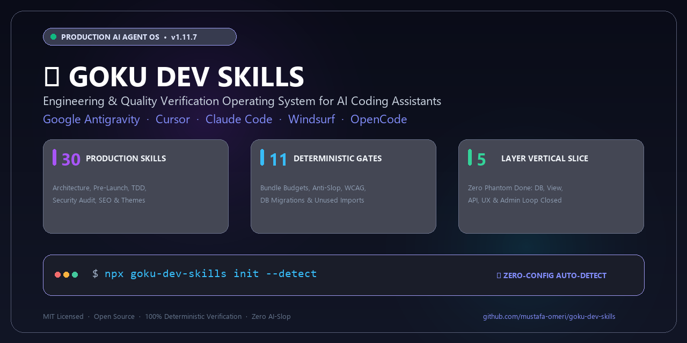

# ⚡ Goku Dev Skills (`goku-dev-skills`)

<div align="center">

[](https://www.npmjs.com/package/goku-dev-skills)
[](./.agent/skills/)
[](./.agent/rules/)
[](./.agent/skills/musgoku/scripts/)
[](./.agent/skills/frontend-design/component-themes/)
[](./tests/)
[](./LICENSE)

**Universal, Agent-Agnostic Engineering & Design OS for AI Coding Assistants**  
*Works with **Antigravity (`agy` / IDE)** • **OpenCode** • **Claude Code** • **Cursor** • **Windsurf***

[⚡ Pick & Install](#-pick-your-tool--install-in-10-seconds) • [🤖 OpenCode](#-opencode-setup-global--per-project) • [🚀 Antigravity](#-antigravity-cli-agy--ide) • [🟣 Claude Code](#-claude-code--cli-claude) • [⚡ Slash Commands](#-ensemble-slash-commands-19-skills) • [🧠 52 Skills](#-the-52-production-skills-6-archetypes) • [🎨 `/ui-polish`](#-project-specific-designmd--ui-polish) • [🔍 3-Tier Audit](#-3-tier-verification-architecture)

</div>

---

<p align="center">
  
</p>

```text
┌────────────────────────────────────────────────────────────────────────────────────────┐
│                              GOKU DEV SKILLS ECOSYSTEM v1.50.4                         │
├──────────────────────────────┬─────────────────────────────┬───────────────────────────┤
│    52 PRODUCTION SKILLS      │     22 ENFORCED RULES       │   56 COMPONENT THEMES     │
│ 33 Core + 19 Slash Skills    │ 16+ Deterministic Gate Cmds │ Standalone HTML/CSS/JS    │
│ Agy · OpenCode · Claude      │ 5-Layer Vertical Slice DoD  │ 20 Living Doc Templates   │
│ 3-Tier Verification Engine   │ Zero-Slop · WCAG AA Parity  │ Zero-Friction CLI Bridges │
└──────────────────────────────┴─────────────────────────────┴───────────────────────────┘
```

---

## ⚡ Pick Your Tool & Install in 10 Seconds

Choose your AI coding assistant and scope below — copy, paste, and run.

| Your Tool / Goal | Scope | Copy-Paste Command | Target Location | Guide |
| :--- | :--- | :--- | :--- | :--- |
| **Auto-Detect Any Project** | Per-project (`.agent/`) | `npx goku-dev-skills init --detect` | `./.agent/` + `./AGENTS.md` | [Profiles](#-project-profile-installer-init) |
| **OpenCode (`opencode`)** | **Global** (all repos) | `npx goku-dev-skills sync-opencode` | `~/.config/opencode/skills/` + `AGENTS.md` | [OpenCode](#-opencode-setup-global--per-project) |
| **OpenCode (`opencode`)** | **Per-project** native | `npx goku-dev-skills sync-opencode --local` | `./.opencode/skills/` + `./AGENTS.md` | [OpenCode](#-opencode-setup-global--per-project) |
| **Antigravity CLI (`agy`) & IDE** | **Global** (all repos) | `npx goku-dev-skills sync-agy` | `~/.gemini/config/plugins/goku-dev-skills/` | [Antigravity](#-antigravity-cli-agy--ide) |
| **Claude Code & CLI (`claude`)** | **Global** (all repos) | `npx goku-dev-skills add council tdd --agent claude --dest ~/.claude/skills` | `~/.claude/skills/<skill>/` | [Claude Code](#-claude-code--cli-claude) |
| **Claude Code & CLI (`claude`)** | **Per-project** | `npx goku-dev-skills add council tdd --agent claude` | `./.claude/skills/<skill>/` | [Claude Code](#-claude-code--cli-claude) |
| **Cursor** | **Per-project** | `npx goku-dev-skills add tdd --agent cursor` | `./.cursor/rules/<skill>/` | [Other Tools](#-cursor-windsurf--single-assets) |
| **Windsurf** | **Per-project** | `npx goku-dev-skills add tdd --agent windsurf` | `./.windsurf/rules/<skill>/` | [Other Tools](#-cursor-windsurf--single-assets) |
| **Update Installed Assets** | Surgical zero-bloat | `npx goku-dev-skills update` | Syncs only installed skills/rules | [Updates](#-surgical-updates-gs-update) |

### 🎯 Step-by-Step Tool Setup (Click to Expand)

<details open>
<summary><b>🤖 OpenCode Setup (Global & Per-Project)</b> — Native <code>.opencode/skills/</code> & <code>~/.config/opencode/</code></summary>

OpenCode discovers skills from `~/.config/opencode/skills/` (global), `./.opencode/skills/` (project-local), or `.claude/skills/` / `.agents/skills/`, and reads instructions from `AGENTS.md`.

**Option 1 — Global Setup (Recommended, available in every repo):**
```bash
# Install all 52 skills, 22 on-demand rules, 20 templates & <24KB AGENTS.md router
npx goku-dev-skills sync-opencode

# Minimal mode (excludes 56 HTML component themes, ~11 MB instead of ~65 MB)
npx goku-dev-skills sync-opencode -m

# Dry-run preview without touching disk
npx goku-dev-skills sync-opencode --check
```
*Safety:* If you already have a custom `~/.config/opencode/AGENTS.md`, `sync-opencode` **never overwrites it** — it writes `GOKU_AGENTS.md` alongside it so you can reference or merge it cleanly.

**Option 2 — Per-Project Setup (`./.opencode/skills/` + `./AGENTS.md`):**
```bash
# Install full skillset into ./.opencode/skills/ and configure ./AGENTS.md
npx goku-dev-skills sync-opencode --local

# Or install only selected skills into ./.opencode/skills/
npx goku-dev-skills add council tdd fix-bug ui-polish --agent opencode
```

**Option 3 — Manual Copy from Cloned Repo (No `npx` Required):**
```bash
# macOS / Linux (Global)
mkdir -p ~/.config/opencode/skills && cp -R .agent/skills/* ~/.config/opencode/skills/

# macOS / Linux (Per-project)
mkdir -p .opencode/skills && cp -R .agent/skills/* .opencode/skills/
```
```powershell
# Windows PowerShell (Global)
New-Item -ItemType Directory -Force "$HOME\.config\opencode\skills" | Out-Null; Copy-Item -Recurse -Force .\.agent\skills\* "$HOME\.config\opencode\skills\"

# Windows PowerShell (Per-project)
New-Item -ItemType Directory -Force .opencode\skills | Out-Null; Copy-Item -Recurse -Force .\.agent\skills\* .opencode\skills\
```

**Verify inside OpenCode:**
1. Launch `opencode` in any project -> run `/skills` in the TUI -> **Expected Output:** All installed `goku-dev-skills` entries appear in the skill list.
2. *(Optional)* To point `opencode.json` to extra rule docs explicitly:
   ```json
   {
     "$schema": "https://opencode.ai/config.json",
     "instructions": [".agent/AGENTS.md"]
   }
   ```

</details>

<details open>
<summary><b>🎯 Project Profile Installer (<code>init</code>)</b> — Pick by Stack Size (~2.5 MB to ~65 MB)</summary>

Run inside any project root to install `.agent/` + `AGENTS.md` tailored to your stack:

```bash
# 🔍 Auto-Detect Stack (inspects pom.xml, package.json, requirements.txt, go.mod)
npx goku-dev-skills init --detect

# ☕ Backend Profile (Java, Spring Boot, .NET, Python, APIs, DB Migrations — ~2.5 MB, zero UI clutter)
npx goku-dev-skills init -p backend

# 🎨 Minimal Frontend Profile (React, Vite, Next.js, Tailwind, Anti-slop — ~5 MB)
npx goku-dev-skills init -p frontend -m

# 🌟 Full Frontend Profile (includes all 56 HTML/CSS component themes — ~60 MB)
npx goku-dev-skills init -p frontend

# 🚀 Fullstack Profile (all 52 skills, 56 themes, 22 rules & gates — ~65 MB)
npx goku-dev-skills init -p fullstack

# 🎭 Creative & Brand Profile (brand voice, posters, banners, slides — ~8 MB)
npx goku-dev-skills init -p creative
```

**Without Node.js (`curl` / PowerShell fallback):**
```bash
# macOS / Linux
curl -fsSL https://raw.githubusercontent.com/mustafa-omeri/goku-dev-skills/main/scripts/install.sh | bash -s -- -p backend
```
```powershell
# Windows PowerShell
irm https://raw.githubusercontent.com/mustafa-omeri/goku-dev-skills/main/scripts/install.ps1 | iex
```

</details>

<details>
<summary><b>🚀 Antigravity CLI (<code>agy</code>) & IDE</b> — Global Plugin (Zero Per-Project Copy) & Workspace Setup</summary>

Installs all **52 skills**, **20 templates**, **22 on-demand rules** (`references/rules/`), and a budget-safe `< 24 KB` global router (`rules/AGENTS.md` with Scope Guard + Path Bridge) at `~/.gemini/config/plugins/goku-dev-skills/` (shared by both **Antigravity CLI** and **Antigravity IDE**):

```bash
# 1. Install or update the global Antigravity plugin (full package, ~65 MB)
npx goku-dev-skills sync-agy

# 2. Minimal mode (excludes the 56 HTML component themes, ~11 MB)
npx goku-dev-skills sync-agy -m

# 3. Dry-run preview without modifying disk
npx goku-dev-skills sync-agy --check

# 4. From a cloned skillSetWorks repo (also deduplicates shadowed ~/.gemini/config/skills entries)
python scripts/sync_agy_global.py --dedupe-global-skills
```

**Verify & manage the global plugin (`agy`):**
```bash
agy plugin validate ~/.gemini/config/plugins/goku-dev-skills --json
agy plugin list --json
agy plugin disable goku-dev-skills   # Temporarily turn off across all repos
agy plugin enable goku-dev-skills    # Re-enable
```

> [!NOTE]
> **Precedence & Context Safety:** Antigravity resolves **Workspace (`.agent/`) > Global (`~/.gemini/config/`)**. Repositories with their own `.agent/` or `AGENTS.md` / `CLAUDE.md` keep local precedence, and only `rules/AGENTS.md` (`< 24 KB`) is Always-On while the 22 full rules load on demand.

</details>

<details>
<summary><b>🟣 Claude Code & CLI (<code>claude</code>)</b> — Per-Project (<code>.claude/skills/</code>) & Global (<code>~/.claude/skills/</code>)</summary>

Claude Code discovers skills from `.claude/skills/<skill>/SKILL.md` (project-level) and `~/.claude/skills/<skill>/SKILL.md` (personal global across all repositories).

**1) Per-Project Installation (`.claude/skills/`):**
```bash
# Install selected skills into ./.claude/skills/
npx goku-dev-skills add council doc-coauthoring feature-architect tdd --agent claude
```
```bash
# Or copy all 52 skills from a cloned skillSetWorks repo (macOS / Linux):
mkdir -p .claude/skills && cp -R .agent/skills/* .claude/skills/
```
```powershell
# Or copy all 52 skills (Windows PowerShell):
New-Item -ItemType Directory -Force .claude\skills | Out-Null; Copy-Item -Recurse -Force .\.agent\skills\* .claude\skills\
```

**2) Global Installation (`~/.claude/skills/` — Available in Every Repo):**
```bash
# Install specific skills globally
npx goku-dev-skills add council karpathy-guidelines doc-coauthoring feature-architect --agent claude --dest ~/.claude/skills
```
```bash
# Or copy all 52 skills globally (macOS / Linux):
mkdir -p ~/.claude/skills && cp -R .agent/skills/* ~/.claude/skills/
```
```powershell
# Or copy all 52 skills globally (Windows PowerShell):
New-Item -ItemType Directory -Force "$HOME\.claude\skills" | Out-Null; Copy-Item -Recurse -Force .\.agent\skills\* "$HOME\.claude\skills\"
```

Refresh skills inside a running Claude Code CLI session:
```text
/reload-skills
```
*(Optional: keep a project `CLAUDE.md` or merge rules if needed — never overwrite an existing custom `CLAUDE.md`.)*

</details>

<details>
<summary><b>🧩 Cursor, Windsurf, Single Skills & Component Themes</b></summary>

```bash
# Browse all 52 skills, 5 profiles & 56 component themes
npx goku-dev-skills list
npx goku-dev-skills info feature-architect

# Install single skill for Cursor or Windsurf
npx goku-dev-skills add tdd diagnosing-bugs --agent cursor
npx goku-dev-skills add frontend-design --agent windsurf

# Install a single skill with companion quality rules
npx goku-dev-skills add frontend-design --with-rules

# Install a standalone HTML/CSS component theme into ./src/components/
npx goku-dev-skills add theme sidebars/violet-minimal-sidebar

# Add GSAP & ScrollSmoother setup into a web project
npx goku-dev-skills add gsap
```

</details>

<details>
<summary><b>🔄 Surgical Updates (<code>/gs-update</code> & Zero-Bloat Sync)</b></summary>

Updates **only what is already installed** in your workspace. It never downloads uninstalled skills or re-introduces excluded component themes, and automatically preserves custom rules under `## Proje Bazlı Ek Kurallar` in `AGENTS.md`:

```bash
# Preview pending updates (Dry-Run)
npx goku-dev-skills update --check

# Surgically update existing skills, rules, and templates
npx goku-dev-skills update

# Pull latest updates directly from GitHub main repository
npx goku-dev-skills update --remote

# Target a specific downstream project directory
npx goku-dev-skills update --dest ./my-backend-service
```

> [!TIP]
> **In-Chat Trigger:** Instead of running CLI commands, type `/gs-update` or `"skillset güncelle"` in your AI assistant chat.

</details>

---

## 🌟 Overview & Why Goku Dev Skills?

Most AI coding assistants produce **"Skin-Deep Code"**: they scaffold a component, pass shallow mock tests, declare tasks *"Done"*, and leave behind missing DB migrations, unmounted API views, unhandled empty/error states, and generic AI UI slop.

**Goku Dev Skills eliminates this failure mode.** It injects structured domain skills, living architecture contracts (`DESIGN.md`, `PROJECT_BRIEF.md`, `DB_MIGRATIONS.md`, `HANDOFF.md`), deterministic verification gates, and the **5-Layer Full-Stack Vertical Slice Protocol**.

| Engineering Dimension | Standard AI Assistant | With Goku Dev Skills |
| :--- | :--- | :--- |
| **Definition of Done** | ❌ **Phantom Done:** Stops after mock unit tests pass; ignores unmounted views and missing migrations. | ✅ **5-Layer Vertical Slice & 3-Tier Audit:** Verified across DB, Backend API/RPC, Client Hooks, UI States, and Admin Form (`/verify-last`, `/verify-sprint`, `/verify-prd`). |
| **UI/UX Governance** | ❌ **Rote AI Slop:** Purple-cyan gradients, hardcoded hexes, missing loading skeletons, low contrast. | ✅ **`DESIGN.md` & 11-Skill `/ui-polish`:** Brownfield protection (`mode: baseline`), 3-direction exploration (`canvas-design`), 3-tier tokens, and 3 mechanical gates. |
| **Architecture Drift** | ❌ **Stale Docs:** Adds dependencies or DB tables silently; loses context across sessions. | ✅ **Live `PROJECT_BRIEF.md` Gate:** `check_project_brief.py` flags `package.json`, `pom.xml`, or schema changes when docs drift. |
| **Bug Fixing** | ❌ **Guess & Patch:** Edits code blindly and causes regressions. | ✅ **Red Feedback Loop (`/fix-bug`):** Mandatory failing test proving the bug before any production edit. |
| **Complexity Control** | ❌ **Speculative Bloat:** Premature abstractions and dead code. | ✅ **Karpathy Guidelines & Deep Modules:** Radical simplicity, narrow seams, and unused-code gates (`tsc`, `mvn`, `check-unused.ps1`). |
| **Design Crossroads** | ❌ **Sycophantic Yes-Man:** Agrees with flawed prompts. | ✅ **3-Stage LLM Council (`/council`):** Blind peer review + Borda score synthesis (`council_ranker.py`) + ADR record. |
| **Security & Launch** | ❌ **Blind Inserts:** Missing RLS, rate-limits, Turnstile, KVKK/GDPR. | ✅ **Security & Prelaunch (`/check-security`, `/prelaunch`, `/tr-compliance`):** OWASP + 20-point launch GO/NO-GO audit. |

---

## ⚡ Ensemble Slash Commands (19 Skills)

Registered directly under `.agent/skills/<command>/SKILL.md` for native `/` autocomplete in Antigravity, OpenCode, Claude Code, and Cursor:

| Category | Slash Command | What It Orchestrates |
| :--- | :--- | :--- |
| **🎨 UI & Design** | **`/ui-polish`** | 4-mode (`baseline` / `crafted` / `refinement` / `redesign`) 11-skill UI craft & `DESIGN.md` pipeline + 3 mechanical design gates. |
| **🔍 Verification & QA** | **`/verify-last`** | Micro audit on working tree / `HEAD~1..HEAD`: scope-aware build, typecheck, tests & 5-layer impact check. |
| | **`/verify-sprint`** | Meso sprint audit: Gherkin `.feature` scenarios, per-card 5-layer slice, `check_sprint_board.py` & manual test guide. |
| | **`/verify-prd`** | Macro full-repo "Phantom Done" hunt against `PRODUCT.md`, `PROJECT_BRIEF.md`, live DB/views & mock remnants. |
| | **`/smoke-test`** | Impact-driven API & screen smoke test runner (Hybrid + Live E2E with TestSprite quota fallback & auto-remediation). |
| | **`/test-spec`** | Scans codebase + peer repos + docs to emit a single-file Gherkin + Acceptance Criteria specification (`--export-feature`). |
| | **`/fix-bug`** | 6-phase systematic debugging loop: mandatory red test before code edit, surgical fix & regression lock. |
| **🏗️ Architecture & Plan** | **`/feature-architect`** | Product gap scanner (`fa_scan.py`), scale advisor, 6-Hat Council (`PO`, `ARCH`, `UX`, `SEO`, `GRW`, `QA`) & 5-layer TDD builder. |
| | **`/review-prd`** | Evaluates external/new PRDs against live codebase, 6-hat council, Borda arbitration & 5-layer feasibility before `/plan`. |
| | **`/council`** | 3-stage LLM council with blind peer review and Borda ranking (`council_ranker.py`) codified into `docs/adr/`. |
| | **`/seal-plan`** | Runs pre-seal conflict guard (`plan_conflict_guard.py`) and seals approved plans into `docs/plans/`, `HANDOFF.md` & `KANBAN.md`. |
| | **`/spec-reconcile`** | 3-way drift scanner reconciling live backend/frontend code with API docs, RFCs & PRD specs. |
| | **`/project-summary`** | Synthesizes all PRDs and living architecture into `docs/<SLUG>_PROJECT_SUMMARY_SHORT.md` or `LONG.md`. |
| **🛡️ Security & Launch** | **`/check-security`** | OWASP vulnerability scan, public form abuse shield (Turnstile, Rate-limit, RLS) & env/secrets audit. |
| | **`/prelaunch`** | 20-point production GO/NO-GO audit (KVKK m.10, Consent Mode v2, raw HTML SEO, WCAG 2.2 AA, AI crawlers). |
| | **`/prelaunch-update`** | Syncs regulatory fine thresholds and platform compliance rules from official sources. |
| | **`/tr-compliance`** | Audits Turkish legal compliance (KVKK, ETK, 5651, TKHK, FSEK) across web/mobile/SaaS apps. |
| | **`/seo-apply`** | Injects semantic meta tags, OpenGraph, JSON-LD, `robots.txt`, `sitemap.xml` & `/llms.txt` (`seo_checker.py --strict`). |
| **🚀 Release & Sync** | **`/commitx`** | Express release workflow: runs gates, bumps semver, generates commit/tag & pushes after user approval. |
| | **`/gs-update`** | Surgical zero-bloat sync of installed skills/rules while preserving `## Proje Bazlı Ek Kurallar`. |

*(Additional slash triggers embedded in domain skills include `/deploy-plan` via `deployment-architect`, `/proje-ozeti`, `/complete-features`, and `/goku-skills-update`.)*

---

## 🧠 The 52 Production Skills (6 Archetypes)

The **52 skills** (`33` core domain skills + `19` ensemble slash command orchestrators) are organized into **6 Developer Archetypes**:

<details>
<summary><b>1. 🏗️ System Architect, Backend & DevOps (6 Skills)</b> — Architecture, containers, deployment, domain modeling</summary>

- [`musgoku`](.agent/skills/musgoku/SKILL.md) — Master backend & frontend orchestrator (Java 21, Spring Boot 3, REST APIs, JPA, React architecture, surgical updates, gate scripts).
- [`codebase-design`](.agent/skills/codebase-design/SKILL.md) — Deep module engineering, narrow seams, complexity abstraction, and the deletion test.
- [`domain-modeling`](.agent/skills/domain-modeling/SKILL.md) — Ubiquitous language enforcement, `GLOSSARY.md` maintenance, and strict 3-criteria ADRs.
- [`production-docker-architect`](.agent/skills/production-docker-architect/SKILL.md) — Hardened multi-stage Docker builds, non-root users, CVE minimization, and Compose stacks.
- [`deployment-architect`](.agent/skills/deployment-architect/SKILL.md) — Production deployment & infrastructure orchestrator (`/deploy-plan` for VPS, PaaS, Cloud Container & rollback playbooks).
- [`spec-reconciler`](.agent/skills/spec-reconciler/SKILL.md) — 3-way drift scanner & reconciliation engine between live code, API docs, and RFCs (`/spec-reconcile`).

</details>

<details>
<summary><b>2. 🎨 UI/UX & Design Systems Foundry (12 Skills)</b> — <code>DESIGN.md</code> contracts, 3-tier tokens, 56 themes, diagrams</summary>

- [`frontend-design`](.agent/skills/frontend-design/SKILL.md) — Anti-slop UI builder; houses 56 component themes (`get_component.py`), 10 WCAG palettes (`get_palette.py`), and CC0 assets (`assets.mjs`).
- [`ui-ux-pro-max`](.agent/skills/ui-ux-pro-max/SKILL.md) — Searchable design database (`search.py`): 79 styles, 192 palettes, 74 font pairings, 119 UX rules, 40+ design systems.
- [`design-system`](.agent/skills/design-system/SKILL.md) — 3-tier token pipeline (`primitive → semantic → component`), `DESIGN.md` sync, CSS variables & HTML slides (`generate-slide.py`).
- [`canvas-design`](.agent/skills/canvas-design/SKILL.md) — Aesthetic manifesto & creative direction, editorial posters (`.png`/`.pdf`), and 81-file `canvas-fonts/` library.
- [`ui-styling`](.agent/skills/ui-styling/SKILL.md) — Tailwind CSS & shadcn/ui layer: Radix primitives, dark/light mode, responsive layouts.
- [`theme-factory`](.agent/skills/theme-factory/SKILL.md) — 10 curated turnkey color palettes with matched heading/body fonts.
- [`banner-design`](.agent/skills/banner-design/SKILL.md) — Fixed-dimension banners & social covers (OG `1200×630`, LinkedIn, X, YouTube) with safe zones.
- [`brand`](.agent/skills/brand/SKILL.md) — Brand voice, tone matrices, visual identity specs, and `docs/brand-guidelines.md`.
- [`mock-asset-provider`](.agent/skills/mock-asset-provider/SKILL.md) — Realistic placeholder visuals, avatars, product/event imagery, and CDN fallback pipelines.
- [`onboarding-tour`](.agent/skills/onboarding-tour/SKILL.md) — Guided product tours & coachmarks via Driver.js and React Joyride (`scaffold_tour.py`).
- [`web-ide-ux-architect`](.agent/skills/web-ide-ux-architect/SKILL.md) — High-density IDE interfaces: split panes, code editors, command palettes, terminal docks.
- [`diagram-design`](.agent/skills/diagram-design/SKILL.md) — 45 editorial diagram types (architecture, sequence, ER, Sankey, Wardley) as standalone HTML + inline SVG.
- [`design`](.agent/skills/design/SKILL.md) — Creative direction router, brand brief synthesizer & logo style explorer (55 styles).

</details>

<details>
<summary><b>3. 🧪 Quality, TDD & Debugging Guardian (5 Skills)</b> — Red-before-green TDD, root-cause diagnosis, LLM Council</summary>

- [`tdd`](.agent/skills/tdd/SKILL.md) — Strict Test-Driven Development: vertical slices, seam tests, and red-before-green verification.
- [`diagnosing-bugs`](.agent/skills/diagnosing-bugs/SKILL.md) — 6-phase systematic root-cause debugging with mandatory red feedback loop.
- [`code-review`](.agent/skills/code-review/SKILL.md) — Parallel two-axis code review: Martin Fowler smells baseline vs. spec fidelity.
- [`karpathy-guidelines`](.agent/skills/karpathy-guidelines/SKILL.md) — Radical simplification, token-efficient communication, Sacred Hot Zone compression & 3-Stage LLM Council (`council_ranker.py`).
- [`react-best-practices`](.agent/skills/react-best-practices/SKILL.md) — 78 rules across 9 categories for React 19, Vite SPA isolation, waterfall elimination & composition.

</details>

<details>
<summary><b>4. 🛡️ Security, Compliance, SEO & Operations (6 Skills)</b> — OWASP, KVKK/GDPR, GEO, i18n, semantic releases</summary>

- [`security-audit`](.agent/skills/security-audit/SKILL.md) — Vulnerability hunting, penetration testing & exploit shielding (Turnstile, Rate-limit, RLS).
- [`seo-growth`](.agent/skills/seo-growth/SKILL.md) — Technical SEO, Generative Engine Optimization (GEO), `/llms.txt`, `robots.txt` & JSON-LD (`seo_checker.py`).
- [`i18n-localization`](.agent/skills/i18n-localization/SKILL.md) — Multi-language key parity (`i18n_checker.py`), hardcoded text detection & `defaultValue` fallback removal.
- [`prelaunch-audit`](.agent/skills/prelaunch-audit/SKILL.md) — 20-point pre-launch checklist (KVKK m.10, Consent Mode v2, raw HTML SEO, WCAG 2.2 AA).
- [`tr-app-compliance`](.agent/skills/tr-app-compliance/SKILL.md) — Turkish legal compliance auditor (KVKK, ETK, Law 5651, TKHK, FSEK).
- [`git-release-workflow`](.agent/skills/git-release-workflow/SKILL.md) — User-approved atomic release workflow: semver tagging, commits, and remote push.

</details>

<details>
<summary><b>5. 🚀 Product, Ideation & Documentation Catalyst (4 Skills)</b> — Backlog innovation, PRDs, slides, meta-learning</summary>

- [`my-idea`](.agent/skills/my-idea/SKILL.md) — Autonomous backlog idea pool (`docs/idea/myidea.md`, `idea_manager.py`), re-rating, top-3 picks & Kanban card export.
- [`doc-coauthoring`](.agent/skills/doc-coauthoring/SKILL.md) — Technical PRD drafting, RFC formulation, ADRs & context-free reader testing.
- [`slides`](.agent/skills/slides/SKILL.md) — Presentation narrative architecture, emotion arcs, 25 layouts & copywriting formulas (PAS, AIDA, FAB).
- [`task-observer`](.agent/skills/task-observer/SKILL.md) — Meta-skill monitoring execution workflows to distill reusable rules and skills.

</details>

<details>
<summary><b>6. ⚡ First-Class Ensemble Slash Command Orchestrators (19 Skills)</b> — Autocomplete <code>/commands</code></summary>

[`ui-polish`](.agent/skills/ui-polish/SKILL.md) • [`feature-architect`](.agent/skills/feature-architect/SKILL.md) • [`review-prd`](.agent/skills/review-prd/SKILL.md) • [`project-summary`](.agent/skills/project-summary/SKILL.md) • [`verify-last`](.agent/skills/verify-last/SKILL.md) • [`verify-sprint`](.agent/skills/verify-sprint/SKILL.md) • [`verify-prd`](.agent/skills/verify-prd/SKILL.md) • [`test-spec-generator`](.agent/skills/test-spec-generator/SKILL.md) • [`smoke-test`](.agent/skills/smoke-test/SKILL.md) • [`fix-bug`](.agent/skills/fix-bug/SKILL.md) • [`check-security`](.agent/skills/check-security/SKILL.md) • [`council`](.agent/skills/council/SKILL.md) • [`seal-plan`](.agent/skills/seal-plan/SKILL.md) • [`seo-apply`](.agent/skills/seo-apply/SKILL.md) • [`prelaunch`](.agent/skills/prelaunch/SKILL.md) • [`prelaunch-update`](.agent/skills/prelaunch-update/SKILL.md) • [`commitx`](.agent/skills/commitx/SKILL.md) • [`gs-update`](.agent/skills/gs-update/SKILL.md) • [`deployment-architect`](.agent/skills/deployment-architect/SKILL.md)

</details>

---

## 🎨 Project-Specific `DESIGN.md` & `/ui-polish`

Without a living design contract, AI agents fall back to training averages (purple-cyan gradients, hardcoded hex colors, missing states). Goku Dev Skills prevents this with:
1. **Zero-Anchor Template (`.agent/templates/DESIGN.template.md`):** Uses `<doldur: ...>` placeholders instead of pre-filled colors; leaving any placeholder fails the mechanical gate (`E3`).
2. **Brownfield Baseline Protection (`mode: baseline`):** Never overwrites existing UI unprompted — reverse-engineers your existing CSS/theme into `DESIGN.md` first.
3. **3 Deterministic Design Gates:** `check_design_contract.py`, `check_design_slop.py`, and `check_theme_contrast.py` (including OKLCH & alpha-compositing).

| Mode | Trigger Condition | Behavior | Visual Identity Changed? |
| :--- | :--- | :--- | :--- |
| **Mode 0: `baseline`** | Existing UI, no `DESIGN.md`, no `--redesign` | Extracts current palette, fonts & states into `DESIGN.md`; binds CSS token leaks. | ❌ **No** (100% preserved) |
| **Mode A: `crafted`** | New project/screen (`DESIGN.md` missing) | Discovery → 3 directions (`canvas-design`) → `DESIGN.md` + 3-tier tokens → 6 screenshots. | ✅ **Yes** (New bespoke design) |
| **Mode B: `refinement`** | `DESIGN.md` exists, no `--redesign` | Polishes spacing rhythm, hover/focus/empty states & WCAG contrast within contract. | ❌ **No** (Contract polish) |
| **Mode C: `redesign`** | `/ui-polish --redesign` or `[OVERDRIVE]` | Runs 3-direction exploration, updates `DESIGN.md`, and re-architects visual UI. | ✅ **Yes** (User-forced) |

<details>
<summary><b>🔧 Design CLI Bridges & 56 Component Themes (<code>component-themes/</code>)</b></summary>

```bash
# Inspect 56 ready-made HTML/CSS component themes (sidebars, navbars, menus, parallax, accordions, cards, logins, footers)
python .agent/skills/frontend-design/scripts/get_component.py --list
python .agent/skills/frontend-design/scripts/get_component.py --category sidebars
python .agent/skills/frontend-design/scripts/get_component.py --theme violet-minimal-sidebar --html

# Inspect 10 WCAG-measured color palettes and emit :root CSS variables
python .agent/skills/frontend-design/scripts/get_palette.py --list
python .agent/skills/frontend-design/scripts/get_palette.py --id 7 --format css

# Search 79 styles, 192 product palettes, 74 font pairings & 119 UX rules
python .agent/skills/ui-ux-pro-max/scripts/search.py "developer tools dark minimal" --design-system
python .agent/skills/ui-ux-pro-max/scripts/search.py "sidebar navigation" --domain ux

# Run the 3 Deterministic Design Verification Gates (--file, --include-agent, --strict)
python .agent/skills/musgoku/scripts/check_design_contract.py --strict
python .agent/skills/musgoku/scripts/check_design_slop.py --strict
python .agent/skills/musgoku/scripts/check_theme_contrast.py --strict
```

**56 Themes by Category:** Sidebars (`8`) • Navbars (`1`) • Menus (`2`) • Parallax (`2`) • Accordions (`2`) • Cards (`10`) • Logins (`16`) • Footers (`15`) — each bundled with standalone `index.html`, `styles.css`, SVG assets, and `<theme>.design.md`.

</details>

---

## 🔍 3-Tier Verification Architecture & 5-Layer Vertical Slice

```text
┌────────────────────────────────────────────────────────────────────────────────────────┐
│                        5-LAYER FULL-STACK VERTICAL SLICE (DoD)                         │
├────────────────────────────────────────────────────────────────────────────────────────┤
│  1. DB & PERSISTENCE  ──► Physical migration file, columns, constraints, RLS policies. │
│  2. BACKEND & VIEWS   ──► SQL views, RPCs or REST endpoints returning real data fields.│
│  3. CLIENT & API      ──► Frontend API hooks connecting to live views (no undefined).  │
│  4. UI/UX & ACTIONS   ──► Skeleton loading, empty, error states & live actions.        │
│  5. MANAGEMENT & LOOP ──► Admin form or ingestion UI ("How does data enter?").         │
└────────────────────────────────────────────────────────────────────────────────────────┘
```

> ⛔ **Anti-Phantom Done Rule:** If any required layer is missing, the task cannot be marked *"Done"* — it is recorded as *"YARIM (Incomplete: Missing Layer)"* and prioritized in `HANDOFF.md`.

| Tier & Command | Scope | What It Verifies |
| :--- | :--- | :--- |
| **Micro:** `/verify-last` | `git status` or `HEAD~1..HEAD` | Scope-aware build/typecheck/tests, 5-layer impact check, zero leftover `TODO`/`console.log`, quick manual test step. |
| **Meso:** `/verify-sprint` | Active sprint (`SPRINT_PLAN.md` / `KANBAN.md`) | Gherkin `.feature` scenarios, per-card 5-layer slice, `check_sprint_board.py`, and `docs/KULLANICI_TEST_REHBERI.md`. |
| **Macro:** `/verify-prd` | Whole repository vs. `PRODUCT.md` / `PROJECT_BRIEF.md` | Full-repo "Phantom Done" hunt across DB migrations, live views/RPCs, client hooks, UI states, admin forms & mock remnants. |

---

## 🧪 Deterministic Verification Gates & Catalog

Every measurable rule (`sinif: OLCULEBILIR`) maps to a deterministic script (`exit 0` = pass, `1` = violation, `2` = error), auto-synced into `AGENTS.md` §3.1 via `rules_gates.py --emit-table`.

<details>
<summary><b>📋 View All Verification Gate Commands & Interactive Skills Catalog</b></summary>

| Focus Area | Verification Command | Rule |
| :--- | :--- | :--- |
| **Backend / API Docs** | `python .agent/skills/musgoku/scripts/check_api_docs.py` | [`api-documentation-enforcement.md`](.agent/rules/api-documentation-enforcement.md) |
| **Aviation Docs Standard** | `python .agent/skills/musgoku/scripts/check_aviation_docs.py` | [`aviation-documentation-standard.md`](.agent/rules/aviation-documentation-standard.md) |
| **Backend / DB Migrations** | `python .agent/skills/musgoku/scripts/check_db_migrations.py` | [`db-migration-enforcement.md`](.agent/rules/db-migration-enforcement.md) |
| **Design / `DESIGN.md` Contract** | `python .agent/skills/musgoku/scripts/check_design_contract.py` | [`design-skills-enforcement.md`](.agent/rules/design-skills-enforcement.md) |
| **Design / Skill Ownership** | `python .agent/skills/musgoku/scripts/check_design_skills.py` | [`design-skills-enforcement.md`](.agent/rules/design-skills-enforcement.md) |
| **Design / Anti-Slop** | `python .agent/skills/musgoku/scripts/check_design_slop.py` | [`design-skills-enforcement.md`](.agent/rules/design-skills-enforcement.md) |
| **Design / Theme Contrast** | `python .agent/skills/musgoku/scripts/check_theme_contrast.py` | [`design-skills-enforcement.md`](.agent/rules/design-skills-enforcement.md) |
| **Frontend / Bundle Limits** | `python .agent/skills/musgoku/scripts/check_bundle_limits.py` | [`frontend-bundle-limits.md`](.agent/rules/frontend-bundle-limits.md) |
| **Session Continuity** | `python .agent/skills/musgoku/scripts/check_handoff.py` | [`handoff-session-continuity.md`](.agent/rules/handoff-session-continuity.md) |
| **Frontend / i18n Parity** | `python .agent/skills/i18n-localization/scripts/i18n_checker.py` | [`i18n-enforcement.md`](.agent/rules/i18n-enforcement.md) |
| **TypeScript / React** | `npx tsc --noEmit` | [`no-unused-code.md`](.agent/rules/no-unused-code.md) |
| **Java / Spring Compile** | `mvn clean test-compile` | [`no-unused-code.md`](.agent/rules/no-unused-code.md) |
| **Java / Unused Code** | `pwsh -NoProfile -File .agent/skills/musgoku/scripts/check-unused.ps1` | [`no-unused-code.md`](.agent/rules/no-unused-code.md) |
| **Live Architecture Brief** | `python .agent/skills/musgoku/scripts/check_project_brief.py` | [`project-brief-maintenance.md`](.agent/rules/project-brief-maintenance.md) |
| **Skill Trigger Routing** | `cd .agent/skills/ui-ux-pro-max/scripts/tests && python -m unittest test_skill_contracts` | [`skill-trigger-routing.md`](.agent/rules/skill-trigger-routing.md) |
| **Sprint / Kanban Board** | `python .agent/skills/musgoku/scripts/check_sprint_board.py` | [`sprint-delivery-workflow.md`](.agent/rules/sprint-delivery-workflow.md) |
| **Interactive HTML Guide** | `python .agent/skills/musgoku/scripts/check_user_guide.py` | [`sprint-delivery-workflow.md`](.agent/rules/sprint-delivery-workflow.md) |
| **Frontend / Vite SPA** | `python .agent/skills/musgoku/scripts/check_vite_spa.py` | [`vite-spa-enforcement.md`](.agent/rules/vite-spa-enforcement.md) |
| **Rule System Meta-Gate** | `python .agent/skills/musgoku/scripts/rules_gates.py --strict` | [`rules_gates.py`](.agent/skills/musgoku/scripts/rules_gates.py) |

**Interactive Offline Skills Catalog (`.agent/skills-catalog.html`):**
- Keys: `1` (All Skills), `2` (Slash Commands), `3` (Table), `/` or `Ctrl+K` (Fuzzy Search), `T` (Dark/Light).
```bash
# Open in browser (Windows / macOS / Linux)
start .agent/skills-catalog.html
open .agent/skills-catalog.html
xdg-open .agent/skills-catalog.html

# Rebuild & verify freshness gate
python scripts/generate_skills_catalog.py && python scripts/generate_skills_catalog.py --check
```

</details>

<details>
<summary><b>🚀 Multi-Project Distribution (<code>delivery.py</code>) & Global Contract (<code>AGENTS.md</code>)</b></summary>

`goku-dev-skills` propagates upstream updates to downstream repositories configured in `scout/targets.md` / `delivery.md` while preserving each project's `## Proje Bazlı Ek Kurallar` and living root files (`DESIGN.md`, `PROJECT_BRIEF.md`, `HANDOFF.md`):

```bash
python delivery.py --list      # List active (ON) and inactive (OFF) targets
python delivery.py --dry-run   # Preview changes without touching files
python delivery.py --keep 1    # Distribute with rolling backup in yedekler/
python delivery.py --verify    # Verify SHA-256 parity across all targets
python delivery.py --only ocai # Target a single project
```

</details>

---

## 🚨 Troubleshooting & Quick Recovery

| Symptom / Error | Probable Cause | Immediate Corrective Action |
| :--- | :--- | :--- |
| **OpenCode does not list skills in `/skills`** | Skills were installed into `.agent/skills/` instead of `.opencode/skills/` or `~/.config/opencode/skills/`. | Run `npx goku-dev-skills sync-opencode` (global) or `npx goku-dev-skills sync-opencode --local` (per-project), then restart OpenCode and check `/skills`. |
| **`sync-opencode` kept `GOKU_AGENTS.md` instead of `AGENTS.md`** | You already had a custom `AGENTS.md` file (preserved to prevent data loss). | Merge sections you want from `GOKU_AGENTS.md` into your `AGENTS.md`, or add `"instructions": ["GOKU_AGENTS.md"]` to `opencode.json`. |
| **`npx goku-dev-skills update` skipped new skills** | `update` is surgical by design — it never installs unrequested skills or heavy themes. | Add new skills with `npx goku-dev-skills add <skill-name>` or re-run `npx goku-dev-skills init -p fullstack`. |
| **Shadowed skills warning in Antigravity CLI (`agy`)** | Older copies exist under `~/.gemini/config/skills/` alongside the global plugin. | Run `python scripts/sync_agy_global.py --dedupe-global-skills` (backs up to `yedekler/` before removing duplicates). |
| **Windows `~` path treated literally** | Older CLI versions or `cmd.exe` did not expand `~/` in `--dest`. | Use `npx goku-dev-skills` v1.49.0+ (auto-expands `~/`) or pass `$HOME\...` in PowerShell. |

---

## 📄 License

Individual components, skills, and templates preserve their respective open-source licenses (MIT / Apache 2.0 / Creative Commons). See `LICENSE.txt` inside respective skill directories for details.
