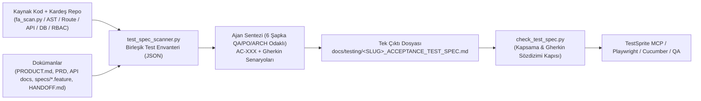

# `test-spec-generator` (`/test-spec`) Uygulama Planı

> **Hedef Dal / Sürüm:** `main` / `v1.40.0` · **Tarih:** `2026-11-20`  
> **Görevlendirilen Skill'ler:** `test-spec-generator` (yeni), `feature-architect` (`fa_scan.py` yeniden kullanımı), `tdd`, `codebase-design`, `doc-coauthoring`, `council`, `musgoku`  
> **Kullanılan MCP'ler:** `second-brain-vault` (bağlam), `TestSprite` (şema & PRD/test-plan uyumu incelemesi)  
> **Desteklenen Ortamlar:** `Antigravity IDE`, `Antigravity CLI (agy)`, `Claude Code (claude)`, `OpenCode (opencode)`, `Genel Terminal / CLI`

---

## 1. Goal Description (Amaç & Mevcut Boşluk Analizi)

### Mevcut Durum: Elimizde Buna Uygun Bir Yapı Var mı?
Kısmen parçaları var ama **doğrudan istediğin işi uçtan uca yapan bir yapı şu an yok**:

| Mevcut Yapı | Ne Yapıyor? | Neden İhtiyacı Karşılamıyor? |
|---|---|---|
| `feature-architect` (`fa_scan.py`) | Tüm kodu + kardeş repoyu tarayıp rota, API endpoint, DB şema, rol ve gap grafiği çıkarıyor. | Test senaryosu, Gherkin veya Acceptance Criteria üretmiyor; yalnızca ürün/gap konsey raporu veriyor. |
| `verify-sprint` & `sprint-delivery-workflow` | Kart bazlı `specs/S1-01.feature` dosyalarının varlığını denetliyor. | Tüm projeyi kapsayan **tek konsolide test/AC dosyası** üretmiyor; mevcut testleri denetliyor. |
| `verify-prd` | Eski kod/PRD sapmalarını ve 5 katman eksikliği bulgularını raporluyor. | Yeni veya tam Gherkin test suite + Acceptance Criteria üretmiyor. |
| `project-summary --long` | Dokümanları (`PRD`, `PRODUCT.md`, `PROJECT_BRIEF.md`) tek özet dosyada birleştiriyor. | Canlı kaynak kodu (form validasyonları, endpoint kontratları, RBAC sınırları) tarayıp Gherkin test çıkarmıyor. |
| `TestSprite` MCP | `testsprite_generate_standardized_prd`, `testsprite_generate_frontend_test_plan`, `testsprite_generate_backend_test_plan`, `testsprite_generate_code_and_execute` araçlarını sunuyor. | Dışarıdan tek bir zengin Gherkin + Acceptance Criteria şartnamesiyle beslenmezse, yalnızca yüzeysel/otomatik çıkarımla yetiniyor. |

### Bu Plan Neyi Başarır?
Projeyi (hem **canlı kaynak kodunu** hem **tüm dokümanlarını** hem varsa **kardeş backend/frontend reposunu**) derinlemesine tarayıp; her modül, rota, API ucu, form/validasyon, DB kuralı ve RBAC rolü için **ölçülebilir Acceptance Criteria (`AC-XXX`)** ve **Gherkin (`Feature` / `Background` / `Scenario` / `Scenario Outline` / `Given-When-Then` / `@tag`)** senaryolarını **tek bir dosyada** (`docs/testing/<SLUG>_ACCEPTANCE_TEST_SPEC.md` — opsiyonel `--format feature` ile `specs/<SLUG>_ALL.feature`) üreten **`test-spec-generator` (`/test-spec`)** yeteneğini kurar.



### Hedeflenen Yeteneğin Kabul Kriterleri (Gherkin)
```gherkin
Feature: Proje Geneli Tek Dosya Gherkin ve Acceptance Criteria Üretici (/test-spec)

  @smoke @cli
  Scenario: Kod ve dokümanlardan tek dosya Gherkin + AC spesifikasyonu üretimi
    Given Hedef projede canlı kaynak kod (rotalar, endpointler, şemalar, roller) ve dokümanlar mevcuttur
    When Kullanıcı "/test-spec" veya "test_spec_scanner.py" çalıştırıp spesifikasyonu üretir
    Then Tüm modüller, uç noktalar, pozitif/negatif/RBAC/edge-case senaryoları tek bir Markdown dosyasında toplanır
    And Her gereksinim benzersiz bir AC-ID ve en az bir Given-When-Then Gherkin senaryosu ile eşleşir
    And check_test_spec.py doğrulama kapısı kapsama eksiği veya placeholder bulmadan Exit 0 döner

  @export @automation
  Scenario: TestSprite ve BDD araçları için dışa aktarım formatları
    Given Üretilmiş tek dosya ACCEPTANCE_TEST_SPEC.md mevcuttur
    When Kullanıcı "--export-feature" veya TestSprite köprü talimatını ister
    Then Tüm Gherkin blokları tek bir geçerli ".feature" dosyasına eksiksiz çıkarılabilir
    And TestSprite MCP çağrısı için hazır port, auth, kapsam ve "additionalInstruction" özeti sunulur
```

---

## 2. 🏛️ Council Deliberation & Alternatif Yaklaşımlar

| Seçenek | Yaklaşım | Avantajlar (+) | Riskler / Dezavantajlar (-) | Borda Puanı |
|---|---|---|---|:---:|
| **Option A** | Mevcut `verify-prd` veya `project-summary` içine ek mod olarak gömmek | Yeni skill dizini açılmaz | Sorumluluklar karışır (`verify-prd` denetler, `project-summary` özetler, test spec üretimi başka bir sözleşmedir) | `1.4` |
| **Option B (Önerilen)** | Bağımsız `test-spec-generator` (`/test-spec`) skill'i + `fa_scan.py` yeniden kullanımı | Tek sorumluluk (deep module), sıfır kod tekrarı (`fa_scan.py` zaten rota/API/DB/RBAC/peer tarıyor), kendi deterministik kapsama kapısı (`check_test_spec.py`) | Katalog, routing kuralı ve test paketi güncellemesi gerektirir | **`2.8`** |
| **Option C** | Yalnızca Python ile regex tabanlı otomatik Gherkin metni bastırmak (LLM sentezsiz) | Hızlı | İş kurallarını, form validasyonlarının anlamsal amacını ve doküman-kod bağlamını kavrayamaz; mekanik ve sığ testler üretir | `1.2` |

- **Seçilen Yol:** **Option B** (`test-spec-generator` skill'i + `fa_scan.py` deterministik envanter çıkarımı + ajan tarafından derin iş kuralı/Gherkin sentezi + `check_test_spec.py` deterministik kapsama kapısı).
- **Hibrit Motor İlkesi:** `test_spec_scanner.py` koddan/dokümandan tek bir tane bile rota, endpoint, tablo, rol veya mevcut `.feature` dosyasının atlanmamasını deterministik olarak garanti eder (No Missed Surface); ajan ise bu envantere iş mantığını, sınır değerlerini (boundary values), negatif/yetki/4 UX durumunu (`Skeleton`, `Empty`, `Error`) Gherkin `Given/When/Then` diline çevirerek yazar; sonunda `check_test_spec.py` her envanter kaleminin dosyada kapsandığını doğrular.

---

## 3. User Review Required & Open Questions

> [!IMPORTANT]
> **Kodlamaya geçmeden önce aşağıdaki 3 karar noktasını netleştirmeni bekliyorum:**

1. **Tek Dosyanın Varsayılan Formatı & Konumu:**
   - **Önerilen (Varsayılan):** `docs/testing/<SLUG>_ACCEPTANCE_TEST_SPEC.md`
     - *İçerik:* Üstte TestSprite ve test otomasyon araçları için **Sistem Bağlamı** (Stack, Base URL/Port, Auth/Test Kullanıcı Rolleri, Veritabanı/Seed gereksinimi), ardından **İzlenebilirlik Matrisi** (`Modül -> Route/Endpoint -> AC-ID -> Scenario-ID -> Etiketler`), ardından her modül için **Acceptance Criteria (`AC-001`..)** ve **Gömülü Gherkin (`gherkin` blokları)**.
     - *Artı olarak CLI bayrağı:* `--export-feature` ile içindeki tüm Gherkin senaryolarını tek tıkla saf `specs/<SLUG>_ALL.feature` dosyasına (Cucumber/Behave/Playwright-BDD uyumlu) ayıklayabilme.
   - *Soru:* Varsayılan çıktı tek `.md` + opsiyonel `--export-feature` olarak uygun mu, yoksa doğrudan saf `.feature` mi istersin?
2. **TestSprite MCP Otomatik Köprüsü:**
   - Skill üretilen tek dosyayı çıkardıktan sonra, eğer kullanıcının oturumunda `TestSprite` MCP aktifse doğrudan `TestSprite` çalıştırma akışını (`testsprite_generate_standardized_prd` + `testsprite_generate_frontend_test_plan` / `backend_test_plan` / `testsprite_generate_code_and_execute` için `additionalInstruction` olarak bu tek dosyanın referans verilmesi) otomatik yönlendirsin mi? (Güvenlik/onay gereği TestSprite sunucuyu ayağa kaldırıp dış tünel açtığı için sadece kullanıcı onaylayınca tetiklenir.)
3. **Slash Komutu & İsimlendirme:**
   - Skill klasör adı: `test-spec-generator`
   - Ana slash komutları: `/test-spec`, `/gherkin-tests` (ve Türkçe doğal tetikleyiciler: *"tüm projeden gherkin testleri çıkar"*, *"kabul kriterleri ve test spesifikasyonu üret"*, *"testsprite için tek test dosyası hazırla"*). Uygun mu?

> **2-Modlu Onay Seçenekleri (Planı Nasıl İlerletelim?):**
> - **Seçenek A — Mühürle & Sıraya Al (`/seal-plan`):** Planı `docs/plans/` altına arşivler, `HANDOFF.md` §3 ve `KANBAN.md` içine kaydeder, kod yazmadan durur.
> - **Seçenek B — Onayla & Hemen Başla (`Proceed` / cevaplarınla birlikte onayla):** Faz 0 arşivlemesini yapıp Faz 1 (TDD Kırmızı Testler) ile `test-spec-generator` skill'ini ve kapılarını hemen inşa etmeye başlar.

---

## 4. Tek Çıktı Dosyasının Anatomisi (`ACCEPTANCE_TEST_SPEC.md`)

Üretilecek tek dosya hem **TestSprite / AI test araçları** hem **Playwright / Cucumber / QA mühendisleri** tarafından ek dosya aramadan doğrudan tüketilebilecek şekilde 6 sabit bölümden oluşacaktır:

1. **Bölüm 0 — Test Ortamı, Mimari & Auth Sözleşmesi (TestSprite / Runner Metadata):**
   - Tech stack, frontend port / backend base URL, peer repo (varsa), seed/mock gereksinimleri, kullanıcı rolleri (`ADMIN`, `USER`, `GUEST` vb.) ve test kimlik doğrulama akışı.
2. **Bölüm 1 — Uçtan Uca Kapsam ve İzlenebilirlik Matrisi (Traceability Matrix):**
   - `Modül | Kaynak (PRD/FR/Dosya) | Route / API Endpoint | AC ID'leri | Gherkin Scenario ID'leri | Öncelik / Tag`
3. **Bölüm 2 — Modül Bazlı Acceptance Criteria (Kabul Kriterleri) & Gherkin Senaryoları:**
   - Her modül için:
     - **İş Kuralları & Kabul Kriterleri (`AC-<MOD>-01..N`):** Ölçülebilir eşikler, validasyon kuralları, RBAC matrisi, 4 UX durumu (`Skeleton` / `Empty` / `Error+Retry` / `Success`).
     - **Gherkin `Feature` Bloğu:**
       - `Background:` (ortak önkoşul — ör. giriş yapmış kullanıcı)
       - `@smoke @happy-path` — Temel başarılı uçtan uca akış
       - `@negative @validation` — Hatalı girdi, boş alan, sınır değer (`Scenario Outline` + `Examples`)
       - `@security @rbac` — Yetkisiz erişim (401/403), IDOR/rol sınırı
       - `@ui @ux-states` — Skeleton, Empty State, Error+Retry ve 375px mobil kırılım
       - `@api @contract` — Backend status code, payload şema ve DB kalıcılık doğrulaması
4. **Bölüm 3 — Çapraz Sistem & E2E Senaryoları (Cross-Module Flows):**
   - Kayıt -> Doğrulama -> Oluşturma -> Listeleme -> Güncelleme -> Silme gibi çok modüllü yaşam döngüsü testleri.
5. **Bölüm 4 — Kapsam Dışı / Varsayımlar / Tespit Edilen Kod-Doküman Çelişkileri:**
   - Kodda stub/404 veya dokümanda eksik olan yerler (`@wip` veya `@blocked` olarak işaretlenir; sahte geçer test yazılmaz).
6. **Bölüm 5 — Otomasyon Çalıştırma Komutları & TestSprite Köprüsü:**
   - TestSprite MCP (`testsprite_bootstrap` -> `testsprite_generate_code_and_execute`) için bu dosyayı baz alan hazır yönerge + `--export-feature` çıktı bilgisi.

---

## 5. 🏗️ 5 Katmanlı / Modüler Tasarım (skillSetWorks Bağlamı)

> `skillSetWorks` bir kural/skill/CLI deposu olduğu için UI/DB yoktur; mimari, mevcut `fa_engine` ve `musgoku` kapı altyapısıyla sıfır tekrarla bütünleşir:

| Bileşen | Sorumluluk & Tasarım | İlgili Dosya |
|---|---|---|
| **1. Keşif & Envanter Çıkarıcı** | `fa_scan.run_scan_with_graph` çıktısını (rotalar, backend endpoint'ler, DB tablolar/alanlar, roller, stub'lar, peer repo) + proje dokümanlarını (`PRODUCT.md`, `PROJECT_BRIEF.md`, `docs/*prd*`, `docs/APIs/`, `DB_MIGRATIONS.md`, `specs/*.feature`, `HANDOFF.md`) okuyup tek bir deterministik `test-inventory.json` üretir. Ayrıca `--export-feature` ile `.md` içindeki tüm `gherkin` bloklarını geçerli tek `.feature` dosyasına ayıklar. | `.agent/skills/test-spec-generator/scripts/test_spec_scanner.py` |
| **2. Deterministik Kalite & Kapsama Kapısı** | Üretilen `ACCEPTANCE_TEST_SPEC.md` dosyasını doğrular: (a) 6 zorunlu bölüm var mı, (b) `AC-` ID'leri ve `Feature`/`Scenario`/`Given`/`When`/`Then` blokları sözdizimsel olarak geçerli mi, (c) placeholder/TODO kalıntısı var mı, (d) `test-inventory.json` içindeki her aktif rota ve API endpoint'i matriste en az 1 senaryoya bağlanmış mı (Coverage Gate), (e) RBAC rolleri varsa `@rbac`/`@security` senaryosu yazılmış mı? | `.agent/skills/test-spec-generator/scripts/check_test_spec.py` |
| **3. Skill Talimatı & Şablon** | Ajanın envanterden nasıl derin Gherkin + AC sentezleyeceğini, anti-pattern'lerden (`tautological`, belirsiz "kullanıcı memnun kalır" cümleleri) nasıl kaçınacağını ve TestSprite/Playwright/Cucumber'a nasıl bağlayacağını tanımlar. | `.agent/skills/test-spec-generator/SKILL.md` + `references/test-spec-template.md` + `.agent/templates/ACCEPTANCE_TEST_SPEC.template.md` |
| **4. Katalog & Routing Entegrasyonu** | Tetikleyici sözlük, slash komutu (`/test-spec`) ve HTML skill kataloğu senkronu (`test_skills_catalog.py` zorunluluğu). | `.agent/rules/skill-trigger-routing.md`, `scripts/generate_skills_catalog.py`, `.agent/skills-catalog.html`, `.agent/AGENTS.md` |
| **5. Regresyon Test Paketi** | `unittest` tabanlı kırmızı-yeşil dikiş noktası testleri (`test_spec_scanner`, `check_test_spec`, `--export-feature` ayıklama, kapsama eksiği yakalama, sahte AC reddi). | `tests/test_test_spec_generator.py`, `tests/run_all.py` |

---

## 6. 🧪 TDD Kırmızı-Yeşil Dikiş Noktaları (Seams) ve Sıralı İcra Fazları

### 📌 Faz 0: Onay Sonrası Mühürleme
1. `archive_plan.py` ile planı `docs/plans/plan_test_spec_generator_<timestamp>.md` altına arşivle.
2. `HANDOFF.md` §3 ve `KANBAN.md` kartını aç (ör. `S2-14` + `specs/S2-14.feature`).

### 🔴 Faz 1: Kırmızı Testler (Red Loop)
- **Test Dosyası:** `tests/test_test_spec_generator.py`
- **Test Edilen Dikiş Noktaları (Public Seams):**
  1. `build_test_inventory(root, peers=...)`: Örnek full-stack (React route + Spring/Express API + SQL/Prisma + `PRODUCT.md` + `specs/*.feature`) geçici repodan deterministik JSON envanteri eksiksiz çıkarır.
  2. `validate_test_spec(spec_path, inventory=...)`: Eksik Gherkin `Given/When/Then` yapısını, `TODO`/placeholder metnini, RBAC senaryosu eksikliğini ve envanterdeki kapsanmamış route/endpoint'i hata koduyla reddeder; tam dosyada `PASS` döner.
  3. `export_feature_file(spec_path, out_path)`: Tek `.md` dosyası içindeki tüm ```` ```gherkin ```` bloklarını birleştirip geçerli tek bir `.feature` dosyasına dönüştürür.
- **Doğrulama:** `python tests/test_test_spec_generator.py` -> **FAIL (KIRMIZI)** kanıtlanır.

### 🟢 Faz 2: Minimal Geçiş Kodu (Green Loop)
- `test_spec_scanner.py` (doğrudan `fa_scan.run_scan_with_graph` çağırarak — kod tekrarsız) ve `check_test_spec.py` yazılır.
- `python tests/test_test_spec_generator.py` -> **PASS (YEŞİL)**.

### 🧩 Faz 3: Skill, Şablon, Routing ve Katalog Entegrasyonu
- `SKILL.md`, `references/test-spec-template.md`, `.agent/templates/ACCEPTANCE_TEST_SPEC.template.md` oluşturulur.
- `.agent/rules/skill-trigger-routing.md`, `.agent/AGENTS.md` §0.1 ve `scripts/generate_skills_catalog.py` güncellenir, `python scripts/generate_skills_catalog.py` çalıştırılır.

### 🧹 Faz 4: Tüm Paket & Kapı Doğrulaması
- `python tests/run_all.py` ve `python .agent/skills/musgoku/scripts/run_all_gates.py` çalıştırılır.
- Kendi projemiz (`skillSetWorks`) üzerinde gerçekçi deneme veya `docs/KULLANICI_TEST_REHBERI.md` güncellemesi yapılır.

---

## 7. Proposed Changes (Önerilen Dosya Değişiklikleri)

### Yeni Skill (`test-spec-generator`)
#### [NEW] `.agent/skills/test-spec-generator/SKILL.md`
- 5 aşamalı protokol: (1) Envanter tarama (`test_spec_scanner.py`), (2) Doküman + kod çapraz analizi, (3) Modül bazlı AC (`AC-XXX`) ve Gherkin (`Given/When/Then`, `Scenario Outline`, `@tag`) sentezi, (4) Tek dosya yazımı & opsiyonel `--export-feature` / TestSprite köprüsü, (5) `check_test_spec.py` kapsama doğrulaması.
#### [NEW] `.agent/skills/test-spec-generator/references/test-spec-template.md`
- `ACCEPTANCE_TEST_SPEC.md` için detaylı örnekli ana şablon ve TestSprite `additionalInstruction` köprü bloğu.
#### [NEW] `.agent/skills/test-spec-generator/scripts/test_spec_scanner.py`
- `fa_scan.run_scan_with_graph` yeniden kullanımı + doküman envanteri (`PRODUCT.md`, `PROJECT_BRIEF.md`, `docs/*prd*`, `docs/APIs/`, `DB_MIGRATIONS.md`, `specs/*.feature`) + `--export-feature` ayıklayıcısı.
#### [NEW] `.agent/skills/test-spec-generator/scripts/check_test_spec.py`
- Deterministik Gherkin + AC kapsama ve kalite kapısı.

---

### Şablon, Katalog ve Kural Entegrasyonu
#### [NEW] `.agent/templates/ACCEPTANCE_TEST_SPEC.template.md`
- Dağıtılan projelerde kullanılacak standart şablon.
#### [MODIFY] `.agent/rules/skill-trigger-routing.md`
- `test-spec-generator` ve `/test-spec` / `/gherkin-tests` pozitif tetikleyicileri + otonom tetikleme satırı.
#### [MODIFY] `scripts/generate_skills_catalog.py` & `.agent/skills-catalog.html`
- `CATEGORIES["Teslimat & Kalite"]` listesine `"test-spec-generator"` eklenmesi ve katalog HTML'inin yeniden üretilmesi.
#### [MODIFY] `.agent/AGENTS.md`
- §0.1 tablosuna test spesifikasyonu / Gherkin çıkarma satırının eklenmesi.

---

### Testler ve Dokümantasyon
#### [NEW] `tests/test_test_spec_generator.py`
- `test_spec_scanner.py` ve `check_test_spec.py` için tam birim & CLI regresyon testleri.
#### [MODIFY] `tests/run_all.py`
- `Test Test Spec Generator` kaydının merkezi test koşucusuna eklenmesi.
#### [NEW] `specs/S2-14.feature`
- Sprint teslimat sözleşmesi (`check_sprint_board.py` uyumu).

---

## 8. Verification Plan (Doğrulama Planı)

### Automated Tests (Otomasyon Testleri)
```powershell
# 1. Yeni skill birim & CLI testleri (Faz 1'de FAIL, Faz 2'de PASS)
python tests/test_test_spec_generator.py

# 2. Katalog ve kural kapıları
python tests/test_skills_catalog.py
python tests/test_rule_gates.py

# 3. Tüm regresyon paketi ve birleşik kapılar
python tests/run_all.py
python .agent/skills/musgoku/scripts/run_all_gates.py
```

### Manual Verification (Kullanıcı Doğrulama Adımları — FAA AC 121-24C Standardı)
1. **Eylem:** Hedef bir projede (ör. `ocai` veya `FEProjectv1`) `python .agent/skills/test-spec-generator/scripts/test_spec_scanner.py --root . --json` komutunu çalıştır. -> **Beklenen Çıktı:** Tüm backend endpoint'leri, frontend rotaları, roller, DB şemaları ve dokümanlar tek JSON çıktısında listelenir.
2. **Eylem:** Üretilen `docs/testing/<SLUG>_ACCEPTANCE_TEST_SPEC.md` üzerinde `python .agent/skills/test-spec-generator/scripts/check_test_spec.py --spec docs/testing/<SLUG>_ACCEPTANCE_TEST_SPEC.md --inventory ...` çalıştır. -> **Beklenen Çıktı:** Kapsam dışı kalan endpoint/rota yoksa `PASS (Exit 0)` basılır.
3. **Eylem:** `python .agent/skills/test-spec-generator/scripts/test_spec_scanner.py --export-feature docs/testing/<SLUG>_ACCEPTANCE_TEST_SPEC.md --out specs/<SLUG>_ALL.feature` çalıştır. -> **Beklenen Çıktı:** Test araçlarının doğrudan parse edebileceği tek `.feature` dosyası oluşur.

---

## 9. 🚨 Ditching & Emergency Exit (Geri Dönüş ve Acil Durum Tablosu)

| Belirti / Hata | Olası Neden | Anında Düzeltici Eylem |
|---|---|---|
| `test_skills_catalog.py` FAIL | `test-spec-generator` `CATEGORIES` sözlüğüne eklenmemiş veya katalog yeniden üretilmemiş | `scripts/generate_skills_catalog.py` içine ekle ve `python scripts/generate_skills_catalog.py` çalıştır |
| `fa_scan` import hatası | `test_spec_scanner.py` `sys.path` içine `feature-architect/scripts` dizinini eklememiş | `SCRIPTS_DIR` yol çözümlemesini dinamik `Path(__file__).resolve().parents[2] / "feature-architect" / "scripts"` yap |
| `check_test_spec.py` yanlış pozitif | Dinamik veya internal sağlık endpoint'leri (`/actuator/health`) senaryo gerektiriyor sanılmış | `--ignore-routes` veya standart internal health/swagger filtre listesi ekle |
